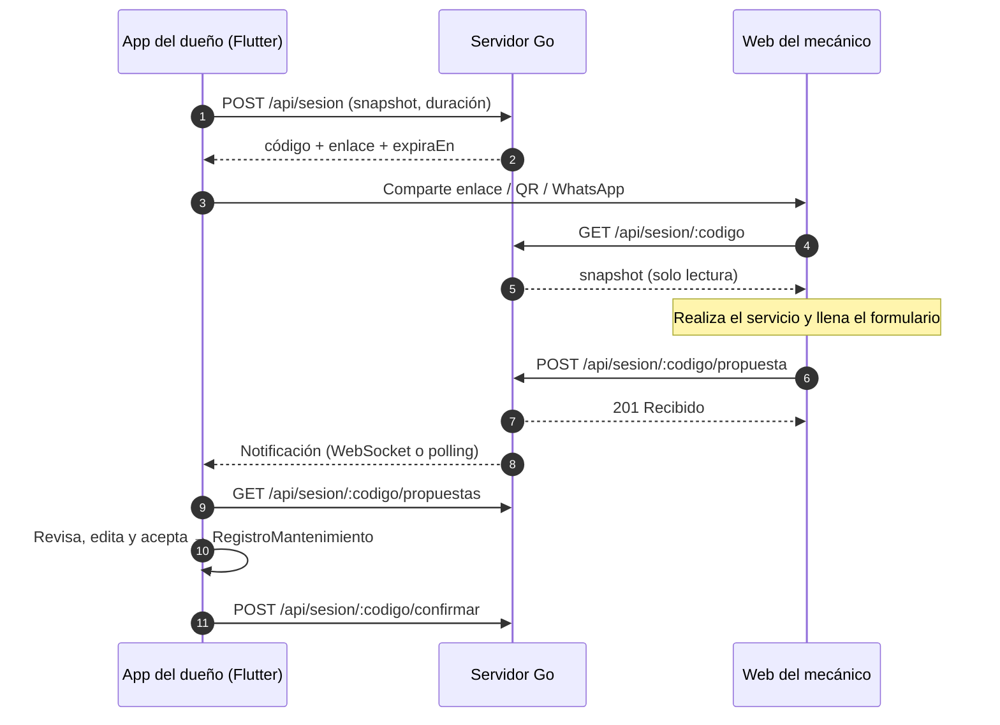
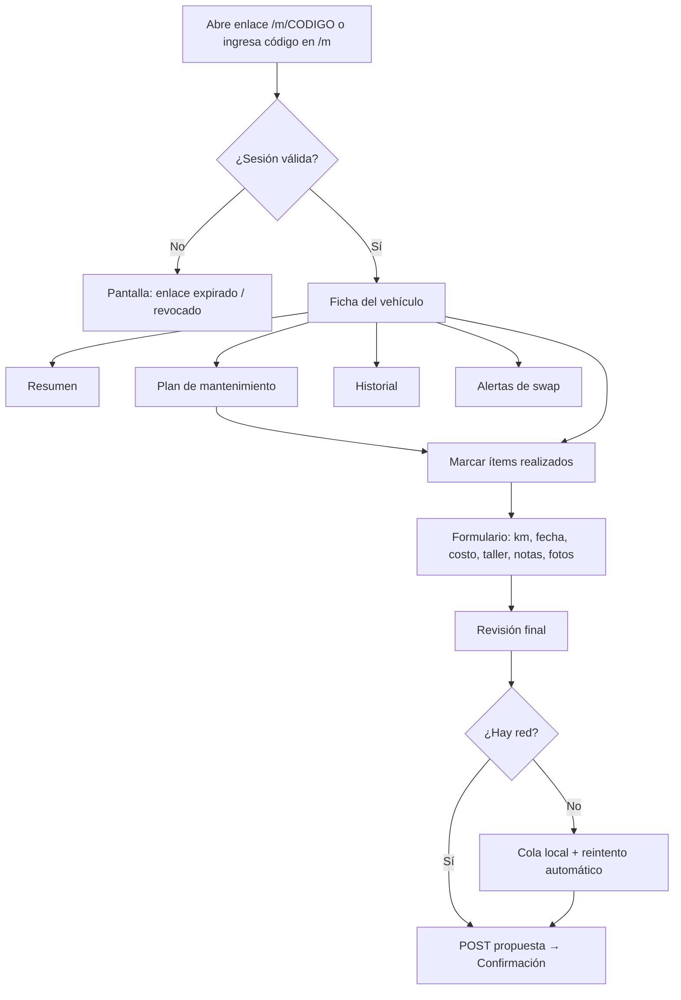
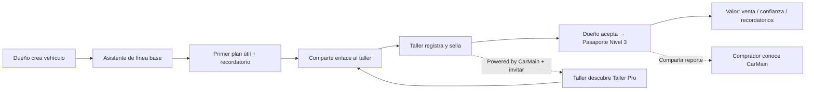
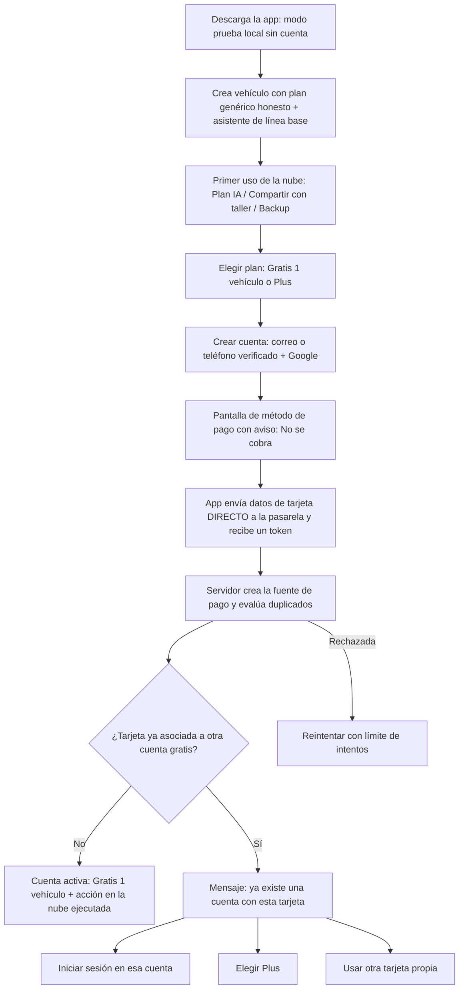

# CarMain · Plan de la Web del Mecánico

> **Versión:** 1.3 · **Fecha:** 2026-11-02 · **Estado:** aprobado para desarrollo — listo para iniciar Fase 0b y Fase 0
> **Alcance:** aplicación web que usa el mecánico/taller para consultar la ficha de un vehículo compartido por su dueño y devolver un registro (propuesta) de lo que hizo.

> **Anexos:** [A · Revisión de la lógica de negocio](#anexo-a--revisión-de-la-lógica-de-negocio-código-actual) · [B · Plan de negocio y mejoras de producto](#anexo-b--plan-de-negocio-y-mejoras-de-producto) · [C · Decisiones confirmadas (Colombia · COP)](#anexo-c--decisiones-confirmadas-y-plan-actualizado-colombia--cop) · [D · Tarjeta verificada en el plan gratis](#anexo-d--tarjeta-verificada-en-el-plan-gratis-antimulticuentas)

---

## 1. Resumen ejecutivo

CarMain ya tiene la app móvil del **dueño** (Flutter, local-first con Drift) y un backend Go (gin) que ya expone los cimientos de la "Web del Mecánico": sesiones con código corto (`A7F9K2`), un snapshot público de solo lectura y un buzón *store-and-forward* de propuestas.

Lo que **falta** es la interfaz web en sí, el contrato de datos (snapshot y propuesta están hoy como `map[string]interface{}` sin esquema) y el flujo de revisión en la app del dueño.

**Idea central:** el mecánico **no instala nada ni crea cuenta**. Abre un enlace (o escribe un código), ve la ficha del vehículo, marca lo que hizo, adjunta fotos y envía. El dueño revisa en su app y, al aceptar, el registro entra a su historial como **Nivel 3 · Sellado por taller** (ya existe `NivelVerificacionHistorial.selladoTaller`).



---

## 2. Objetivos

### 2.1 Objetivos de producto
| # | Objetivo | Métrica de éxito |
|---|----------|------------------|
| O1 | El mecánico accede a la ficha **sin fricción** (sin app, sin registro) | ≤ 10 s desde tocar el enlace hasta ver la ficha |
| O2 | El mecánico registra un servicio completo desde el celular **en el taller** | ≤ 2 min para un servicio de 3–5 ítems |
| O3 | El dueño recibe registros **confiables y estructurados** (no texto libre) | ≥ 80 % de propuestas con ítems vinculados a `itemId` del plan |
| O4 | Aumentar la calidad del historial (Pasaporte Digital) | % de registros Nivel 3 sobre el total |
| O5 | Funcionar con **mala conectividad** típica de un taller | 0 propuestas perdidas por corte de red |

### 2.2 No-objetivos (v1)
- Cuentas de taller, login, facturación, cotizaciones, inventario o agenda de citas.
- Chat en tiempo real dueño ↔ mecánico (el relay WebSocket existente queda para una fase posterior).
- Edición del plan o de los datos del vehículo por parte del mecánico (solo lectura + propuesta).
- Multi-vehículo / multi-cliente por mecánico (un enlace = un vehículo).
- App nativa para mecánicos.

---

## 3. Usuarios y escenarios

### 3.1 Perfiles
| Perfil | Contexto de uso | Implicación de diseño |
|--------|----------------|----------------------|
| **Mecánico de taller** | De pie, manos sucias/guantes, celular de gama media-baja, luz fuerte, datos móviles inestables | Botones grandes (≥ 48 px), alto contraste, poco texto, tolerancia a offline |
| **Mecánico independiente / aficionado** (swaps, proyectos) | Más técnico, le interesan alertas de ingeniería del swap | Mostrar detalle técnico (códigos de motor/caja, alertas) |
| **Encargado de recepción** (desktop) | Revisa la ficha en una PC antes de recibir el auto | Layout responsive de 2 columnas en pantallas ≥ 1024 px |

### 3.2 Escenarios clave
1. **Servicio rutinario:** el dueño deja el auto, comparte el enlace; el mecánico abre la ficha, ve qué ítems están *vencidos/próximos*, hace el cambio de aceite y filtros, los marca, pone costo y fotos, envía.
2. **Diagnóstico con swap:** el mecánico lee las *alertas de ingeniería* (cuellos de botella, soportes, refrigeración) antes de intervenir.
3. **Servicio no previsto en el plan:** repara algo fuera del plan (ítem libre) y lo registra con categoría.
4. **Sin señal:** completa el formulario, queda en borrador/cola local y se envía solo cuando vuelve la red.
5. **Enlace expirado o revocado:** el mecánico ve un mensaje claro y cómo pedir un nuevo enlace.

---

## 4. Flujo de usuario (mecánico)



---

## 5. Arquitectura propuesta

### 5.1 Decisión de stack del frontend

| Opción | Pros | Contras | Veredicto |
|--------|------|---------|-----------|
| **A. SPA ligera (Vite + Preact/Svelte + TypeScript)** servida por el propio servidor Go (`go:embed`) | Carga < 100 KB, rápida en celulares baratos, mismo origen (sin CORS), un solo deploy/servicio systemd, PWA simple | Sin reutilización directa de código Dart; hay que replicar tokens de diseño y lógica de estado de ítems | ✅ **Recomendada** |
| B. Flutter Web | Reutiliza modelos y tema | Bundle de varios MB (CanvasKit), arranque lento con datos móviles, accesibilidad web inferior, mal ajuste a "abrir un enlace al vuelo" | ❌ |

> [!NOTE]
> **Decisión confirmada (2026-11-02):** se adopta la **opción A** (SPA ligera servida por Go). Flutter Web queda descartado.

### 5.2 Estructura de carpetas

```
CarMain/
├── app/                      ← Flutter (dueño) — se amplía con compartir/revisar
├── servidor-go/              ← Backend — se amplía (esquemas, adjuntos, seguridad)
│   └── webmecanico/          ← NUEVO: embed del build estático + handler SPA
└── web-mecanico/             ← NUEVO: código fuente de la SPA
    ├── src/
    │   ├── routes/           ← Ingresar, Ficha, Servicio, Enviado, Error
    │   ├── components/       ← Tarjeta de ítem, Badge de estado, Uploader, ...
    │   ├── lib/              ← api.ts, estado-item.ts, cola-offline.ts, formato.ts
    │   ├── styles/           ← tokens.css (paleta CarMain), base.css
    │   └── types/            ← Snapshot, Propuesta (generados del contrato)
    ├── public/               ← manifest.webmanifest, iconos, service worker
    └── vite.config.ts
```

### 5.3 Rutas web

| Ruta | Pantalla |
|------|----------|
| `/m` | Ingresar código (con scanner QR opcional) |
| `/m/:codigo` | Ficha del vehículo (tabs) |
| `/m/:codigo/servicio` | Formulario de servicio (borrador autoguardado) |
| `/m/:codigo/enviado` | Confirmación de envío |
| `/m/:codigo/expirado` | Sesión inválida/expirada/revocada |

---

## 6. Diseño de interfaz

### 6.1 Principios
1. **Legible al sol y con guantes:** contraste AA mínimo (objetivo AAA en texto principal), targets ≥ 48 px, tipografía ≥ 16 px en cuerpo.
2. **Una acción primaria por pantalla.**
3. **Estado antes que detalle:** lo urgente (*vencido*, *próximo*) siempre arriba.
4. **Mobile-first**, enriquecido en desktop.
5. **Coherencia con la app del dueño:** misma identidad visual (navy, dorado, verde racing).
6. **Tolerante a fallos:** nada se pierde si se cierra la pestaña o cae la red.

### 6.2 Sistema de diseño (tokens heredados de `app/lib/main.dart`)

**Color — tema claro (por defecto en taller)**

| Token | Hex | Uso |
|-------|-----|-----|
| `--primary` | `#1A1A2E` | Textos principales, header, botón primario |
| `--on-primary` | `#FAF8F5` | Texto sobre primario |
| `--secondary` | `#C9A96E` | Acento dorado, foco de inputs, detalles |
| `--tertiary` | `#2D6A4F` | Estado "Al día", confirmaciones |
| `--surface` | `#FAF8F5` | Fondo |
| `--surface-variant` | `#EDE8E0` | Cards (50 % alpha) |
| `--outline` / `--outline-variant` | `#D4C5B0` / `#E8E0D4` | Bordes |
| `--error` | `#B33951` | Estado "Vencido", errores |
| `--warning` | `#B36B00` | Estado "Próximo" (en oscuro `#E5A94A`) |

**Tema oscuro** (automático por `prefers-color-scheme`): `surface #0F0F1A`, `on-surface #E8E0D4`, `primary #E8E0D4`, `tertiary #52B788`, `error #FF6B6B`.

**Tipografía:** *Outfit* (encabezados, 600–700) + *Inter* (cuerpo). Cargar con `font-display: swap` y subset latino; fallback `system-ui`.

**Forma y espaciado:** radio 14 px (controles) / 20 px (cards) / 24 px (diálogos y bottom sheets). Escala de espaciado 4 · 8 · 12 · 16 · 24 · 32. Sin sombras fuertes: bordes sutiles.

**Estados de ítem** (misma lógica que `EstadoItem` y `estado_plan.dart`):

| Estado | Ícono | Color | Etiqueta |
|--------|-------|-------|----------|
| `vencido` | ⚠ | `--error` | "Vencido hace X km" |
| `proximo` | ⏱ | `--warning` | "Faltan X km" |
| `ok` | ✔ | `--tertiary` | "Al día" |

> Nunca depender solo del color: siempre ícono + texto (accesibilidad daltonismo).

### 6.3 Wireframes (móvil, 390 px)

**① Ingresar código `/m`**
```
┌──────────────────────────────┐
│  ◉ CarMain · Taller          │
│                              │
│   Ficha del vehículo         │
│   Ingresa el código que te   │
│   compartió el dueño         │
│                              │
│   ┌──┬──┬──┬──┬──┬──┐        │
│   │A │7 │F │9 │K │2 │        │
│   └──┴──┴──┴──┴──┴──┘        │
│                              │
│   [   Ver ficha   ]          │
│   [ 📷 Escanear QR ]         │
│                              │
│   ¿Sin código? Pídeselo al   │
│   dueño desde su app.        │
└──────────────────────────────┘
```

**② Ficha — pestaña Resumen**
```
┌──────────────────────────────┐
│ ◉ Toyota Supra 1995   ⏱ 23h  │  ← expira en
│ ──────────────────────────── │
│ ┌──────────────────────────┐ │
│ │ [avatar]  Toyota Supra   │ │
│ │ 1995 · RWD · 142.300 km  │ │
│ │ 2JZ-GTE (swap) · A340E   │ │
│ │ ⚠ 2 vencidos · ⏱ 3 próx. │ │
│ └──────────────────────────┘ │
│ Resumen | Plan | Historial | │
│ Alertas                      │
│ ──────────────────────────── │
│  Urgente ahora               │
│  ⚠ Cambio aceite motor       │
│    Vencido hace 800 km       │
│  ⚠ Líquido de frenos         │
│    Vencido hace 2.100 km     │
│  ⏱ Filtro de aire            │
│    Faltan 600 km             │
│                              │
│ ┌──────────────────────────┐ │
│ │ ▶ Registrar servicio     │ │  ← CTA fijo inferior
│ └──────────────────────────┘ │
└──────────────────────────────┘
```

**③ Plan de mantenimiento** — filtros (chips): *Todos · Vencidos · Próximos · Al día*; ítems agrupados por `CategoriaMantenimiento` en secciones colapsables. Cada ítem: descripción, intervalo (km / meses, severo si aplica), última vez, estado y badge de fuente/confianza (*OEM · Alta*). Ítems `esVigilanciaSwap` con etiqueta "Vigilancia swap". Cada ítem tiene un **checkbox grande** para añadirlo al servicio.

**④ Alertas de ingeniería (swap)** — tarjetas por `severidad` (Riesgo alto / Térmica-Fluidos / Mejora): vector, componente afectado, diagnóstico, recomendación de upgrade. Solo se muestra la pestaña si hay alertas.

**⑤ Historial** — línea de tiempo con fecha, km, ítems, taller y **insignia de verificación** (Nivel 1/2/3). Evidencia como miniaturas (lightbox).

**⑥ Registrar servicio `/servicio`** (stepper de 3 pasos con progreso)
```
 Paso 1 · ¿Qué hiciste?          Paso 2 · Datos            Paso 3 · Revisar
 ┌──────────────────────────┐   ┌──────────────────────┐  ┌───────────────────┐
 │ ☑ Cambio aceite motor    │   │ Km actual  [142.300] │  │ 3 ítems           │
 │ ☑ Filtro de aceite       │   │ Fecha      [hoy    ] │  │ 142.300 km        │
 │ ☐ Líquido de frenos      │   │ Costo      [$      ] │  │ Costo: $85        │
 │ ＋ Agregar otro trabajo  │   │ Taller     [       ] │  │ 2 fotos           │
 │   (categoría + texto)    │   │ Mecánico   [       ] │  │ Notas: ...        │
 │                          │   │ Notas      [       ] │  │ ──────────────    │
 │ [  Siguiente  ]          │   │ 📷 Fotos/facturas    │  │ [ Enviar al dueño]│
 └──────────────────────────┘   └──────────────────────┘  └───────────────────┘
```

**⑦ Enviado** — check grande verde, "Enviado a [dueño]. Recibirá tu registro para revisarlo", resumen y botón "Registrar otro servicio" (mismo enlace, sigue válido hasta expirar).

**⑧ Expirado/revocado** — ilustración simple, texto claro, sin filtrar detalles ("El enlace ya no está disponible. Pide uno nuevo al dueño.").

### 6.4 Desktop (≥ 1024 px)
Dos columnas: izquierda **ficha + tabs**, derecha **panel "Servicio en curso"** persistente (lista de ítems marcados, totales, botón enviar). Máximo 1200 px de ancho.

### 6.5 Accesibilidad
- Semántica HTML correcta, foco visible dorado (`--secondary`, 2 px), orden de tab lógico.
- `aria-live` para toasts de envío/errores; etiquetas en todos los inputs.
- Respeto de `prefers-reduced-motion` y `prefers-color-scheme`.
- Inputs numéricos con `inputmode="numeric"`; teclado apropiado para costo/km.
- Idioma `es`; textos externalizados para futura i18n (en/pt).

### 6.6 Microcopy (tono)
Directo, técnico y respetuoso, en español neutro: "Registrar servicio", "Enviar al dueño", "Vencido hace 800 km". Errores accionables: "Sin conexión. Guardamos tu registro y lo enviaremos solo."

---

## 7. Funcionalidades por módulo

### 7.1 Ficha del vehículo (solo lectura)
- Identidad: marca, modelo, año, trim, drivetrain, VIN (si el dueño lo comparte), km actual, tipo de uso (normal/severo) y notas de uso.
- Componentes: motor (código, cilindrada, aspiración, potencia, torque, combustible), transmisión (tipo, marchas, código), componentes extra, **badge SWAP** con componente original.
- Resumen de estado del plan (vencidos / próximos / al día).

### 7.2 Plan
- Cálculo de estado **en el cliente** con la misma regla que Dart (`intervaloEfectivoKm`, `intervaloEfectivoMeses`, uso severo, `ultimaVezKm/Fecha`). Ver §10.3: se valida con vectores de prueba compartidos para evitar divergencias.
- Filtros, agrupación por categoría, búsqueda por texto.

### 7.3 Registro de servicio (propuesta)
- Selección de ítems del plan **y** ítems libres (categoría + componente + descripción).
- Datos: kilometraje (validación: ≥ km actual del snapshot, aviso si salto > 20 %), fecha (no futura), costo opcional, taller, nombre del mecánico, notas.
- Adjuntos: hasta 5 fotos/facturas. **(Fase 4 — fuera del MVP; en el MVP solo se envía texto/estructura.)**
- Autoguardado de borrador, validación en línea, pantalla de revisión.

### 7.4 Offline / PWA
- `manifest.webmanifest` + service worker (cache de la app shell y de la última ficha).
- **Cola de envío** en IndexedDB con reintentos exponenciales; `id` de propuesta (UUID v4) generado en cliente → **idempotencia** (el servidor ignora duplicados).
- Indicador de estado de red y de cola ("1 pendiente de envío").

### 7.5 Seguridad percibida y confianza
- Mostrar claramente "Solo lectura: no puedes modificar los datos del dueño".
- Mostrar expiración (cuenta regresiva) y qué datos se comparten.

---

## 8. Cambios en la app del dueño (Flutter)

Hoy `ApiClient` ya tiene `crearSesion`, `revocarSesion`, `obtenerPropuestasPendientes`, `confirmarPropuestas`, pero **no existe UI** que los use (la tabla `SesionesMecanico` está creada sin pantalla asociada).

| Pantalla / componente | Descripción |
|-----------------------|-------------|
| **Botón "Compartir con taller"** en `detalle_vehiculo_screen.dart` | Abre bottom sheet de compartir |
| **Bottom sheet de compartir** | Elegir duración (1 h · 24 h · 7 días), qué incluir (VIN, notas de uso, historial: sí/no), generar enlace, **QR**, copiar, compartir por WhatsApp (`share_plus`) |
| **Sesiones activas** | Lista con estado (esperando / consultada / propuesta recibida), expiración, botón **Revocar** |
| **Bandeja de propuestas** (badge en detalle del vehículo y dashboard) | Muestra propuestas pendientes de cada sesión |
| **Pantalla de revisión de propuesta** | Diff claro: ítems, km, costo, fotos, notas; editar antes de aceptar; **Aceptar** (crea `RegistroMantenimiento` con `sesionTallerId`, actualiza `ultimaVezKm/Fecha` del plan y la lectura de km con fuente `mantenimiento`) o **Rechazar** |
| **Construcción del snapshot** | `SnapshotMecanico.desde(vehiculo, plan, registros, opciones)` con versionado de esquema |
| **Recepción de propuestas** | Polling al abrir la app/pantalla + WebSocket (relay) si está conectado |

**Dependencias nuevas:** `qr_flutter`, `share_plus`. (Opcional: `flutter_local_notifications` para avisar de propuesta nueva.)

**Persistencia local:** nueva tabla `PropuestasRecibidas` (`id`, `sesionId`, `vehiculoId`, `jsonCrudo`, `estado`: pendiente/aceptada/rechazada, `recibidaEn`) con migración de Drift (subir `schemaVersion`). Evita perder la propuesta tras `confirmar` (que vacía el buzón del servidor).

---

## 9. Backend (Go) — cambios

### 9.1 Estado actual (ya existe)
| Endpoint | Auth | Función |
|----------|------|---------|
| `POST /api/sesion` | API key | Crea sesión (código 6 chars, 24 h por defecto) |
| `DELETE /api/sesion/:codigo` | API key | Revoca |
| `GET /api/sesion/:codigo` | **Pública** | Snapshot para el mecánico |
| `POST /api/sesion/:codigo/propuesta` | **Pública** | Deposita propuesta en buzón |
| `GET /api/sesion/:codigo/propuestas` | API key | Dueño lee buzón |
| `POST /api/sesion/:codigo/confirmar` | API key | Dueño vacía buzón |
| `GET /relay?sesion=` | API key | WebSocket dueño ↔ dueño/mecánico |

### 9.2 Contrato: `Snapshot` v1 (`GET /api/sesion/:codigo` → `snapshot`)
```jsonc
{
  "schema": 1,
  "generadoEn": "2026-11-02T08:00:00Z",
  "vehiculo": {
    "marca": "Toyota", "modelo": "Supra", "anio": 1995, "trim": "RZ",
    "vin": null,                      // solo si el dueño lo autoriza
    "drivetrain": "RWD",
    "kilometrajeActual": 142300,
    "tipoUso": "normal",              // normal | severo
    "notasUso": null,                 // solo si el dueño lo autoriza
    "motor": { "codigo": "2JZ-GTE", "esSwap": true, "original": "1JZ-GE",
               "combustible": "gasolina", "cilindrada": 3.0, "cilindros": 6,
               "aspiracion": "Twin-Turbo", "potenciaHp": 320, "torqueNm": 440 },
    "transmision": { "codigo": "A340E", "esSwap": false, "tipo": "automatica", "marchas": 4 },
    "componentesExtra": []
  },
  "plan": {
    "version": 3,
    "items": [ { "id": "...", "categoria": "motor", "descripcion": "Cambio de aceite",
                 "componenteAplica": "motor", "intervaloKm": 10000, "intervaloMeses": 12,
                 "intervaloSeveroKm": 5000, "ultimaVezKm": 141500,
                 "ultimaVezFecha": "2026-06-01", "fuente": "oem", "confianza": "alta",
                 "esVigilanciaSwap": false } ],
    "alertasIngenieria": []
  },
  "historial": [ { "id": "...", "fecha": "2026-06-01", "kilometraje": 141500,
                   "items": [ { "categoria": "motor", "descripcion": "..." } ],
                   "taller": "...", "nivelVerificacion": "selladoTaller",
                   "evidencia": 2 } ]   // solo conteo; no se exponen fotos del dueño
}
```
Los enums usan **exactamente** los mismos valores de `app/lib/models/enums.dart` y `shared/models.go`.

### 9.3 Contrato: `Propuesta` v1 (`POST /api/sesion/:codigo/propuesta`)
```jsonc
{
  "schema": 1,
  "id": "uuid-v4",                    // idempotencia
  "creadaEn": "2026-11-02T10:15:00Z",
  "mecanico": { "taller": "Taller Pérez", "nombre": "Juan" },   // texto libre, opcional
  "kilometraje": 142300,
  "fecha": "2026-11-02",
  "costo": 85000,                     // opcional · entero en pesos colombianos
  "moneda": "COP",
  "notas": "…",                       // ≤ 2000 chars
  "itemsRealizados": [
    { "itemId": "<id del plan | null>", "categoria": "motor",
      "componenteAplica": "motor", "descripcion": "Cambio de aceite" }
  ],
  "adjuntos": [ { "id": "uuid", "nombre": "factura.jpg", "mime": "image/jpeg", "bytes": 412345 } ]
}
```

### 9.4 Endpoints nuevos / modificados
| Cambio | Detalle |
|--------|---------|
| **Servir la SPA** | `r.GET("/m/*path", webmecanico.Handler)` con `go:embed dist`; fallback a `index.html`; cabeceras de cache (hash en assets, `no-cache` en HTML) |
| **Esquemas tipados** | Reemplazar `map[string]interface{}` por structs (`SnapshotV1`, `PropuestaV1`) con validación (`binding`) y límites |
| **Idempotencia** | `GuardarPropuesta` ignora `id` repetido y responde `200` con el mismo resultado |
| **Adjuntos** *(Fase 4)* | `POST /api/sesion/:codigo/adjunto` (multipart, ≤ 2 MB, solo `image/jpeg|png|webp`, máx. 5 por sesión) y `GET .../adjunto/:id` para el dueño (con API key); borrado al confirmar/expirar |
| **Estado de sesión** | Campo `consultadaEn` (primera vista) para mostrar al dueño "el taller ya abrió el enlace" |
| **Limpieza** | Goroutine periódica que elimina sesiones expiradas (hoy `Eliminar` existe pero nada lo invoca) |
| **Persistencia** *(Fase 4)* | Persistir sesiones y propuestas (PostgreSQL ya contemplado en `.env.example`, con fallback a memoria). Hoy un reinicio del servicio pierde todas las sesiones y propuestas |
| **Corrección `MensajeRelay.Payload`** | Go serializa `[]byte` como **string base64**, pero `RelayMessage.fromJson` en Dart hace `(json['payload'] as List)` → fallaría con una notificación real de `propuesta_mecanico`. Unificar (base64 en ambos lados) |

---

## 10. Seguridad, privacidad y robustez

### 10.1 Riesgos detectados en el código actual
| Riesgo | Dónde | Mitigación |
|--------|-------|------------|
| Endpoints públicos **sin rate limit** ni `CapsMiddleware` | `router.go` (`/api/sesion/:codigo` y `/propuesta`) | Rate limit por IP (p. ej. 30/min) + límite de intentos fallidos por IP (429 con `Retry-After`) |
| Código de **6 caracteres** (32⁶ ≈ 10⁹) adivinable por fuerza bruta si no hay límites | `session.go` | Rate limit + enlace con **token largo** (≥ 128 bits) además del código corto para ingreso manual; el código corto con TTL menor |
| `POST /propuesta` acepta **JSON arbitrario sin límite de tamaño** | `handler.go` | `http.MaxBytesReader` (≤ 64 KB para JSON), validación de campos y longitudes |
| Spam/abuso del buzón | `GuardarPropuesta` | Máx. 20 propuestas por sesión; deduplicación por `id` |
| Sin **CORS** configurado (el comentario en `relay.go` lo da por hecho) | `router.go` | Servir la SPA **mismo origen** (no requiere CORS); si se separa, allowlist explícita |
| `GenerarCodigoUnico` mantiene `RLock` durante el bucle y la creación posterior es otra sección crítica (carrera teórica de colisión) | `session.go` | Generar y registrar de forma atómica bajo un solo `Lock` |
| `run_dev.ps1` contiene una API key en claro | raíz | Está en `.gitignore`; confirmar que **nunca** se versionó (revisar historial de git) y rotarla si lo estuvo |

### 10.2 Privacidad
- El dueño decide qué se comparte (VIN, notas de uso, historial). **Por defecto:** sin VIN ni notas.
- Nunca se expone `propietarioId`, `duenoDeviceId` ni datos personales del dueño.
- Fotos del dueño no se transmiten al taller; solo conteo.
- Las sesiones **expiran** (por defecto 24 h) y pueden **revocarse** al instante.
- Cabeceras: `Referrer-Policy: no-referrer`, `X-Content-Type-Options: nosniff`, `Cache-Control: no-store` en las respuestas de sesión, CSP estricta en la SPA.
- Evitar el token en logs (el enlace va en el *path*; no loguear el path completo de `/api/sesion/:codigo` o enmascararlo).

> [!WARNING]
> **E2EE:** la documentación del relay dice que los payloads van cifrados de extremo a extremo, pero el camino web **no** lo está: el snapshot se guarda en claro en el servidor. Para v1 se asume el servidor como parte de confianza; cifrado en cliente (clave en el *fragment* `#k=` del enlace, que no viaja al servidor) queda como mejora de fase 5.

### 10.3 Confianza del "sellado por taller"
Cualquier persona con el enlace podría enviar una propuesta que, al aceptarse, quedaría como **Nivel 3**. Mitigaciones v1:
- **El dueño siempre aprueba** (nada entra al historial automáticamente).
- Mostrar el nombre del taller/mecánico declarado en la revisión.
- Futuro: talleres verificados (cuenta + sello), firma de la propuesta.

### 10.4 Consistencia Dart ↔ TypeScript
La lógica de estado de ítems existe en Dart (`ItemMantenimientoX.estado`). Para evitar divergencias, crear **vectores de prueba JSON compartidos** (`/contrato/estado_items.json`: entradas → estado esperado) que ejecuten tanto `flutter test` como `vitest`.

---

## 11. Plan de implementación por fases

| Fase | Contenido | Entregable | Estimación* |
|------|-----------|------------|-------------|
| **0. Contrato y cimientos** | Definir `SnapshotV1`/`PropuestaV1` (structs Go + tipos TS + clases Dart), vectores de prueba compartidos, arreglar bug de `Payload`, rate limit + límites de tamaño en endpoints públicos, limpieza de sesiones | Contrato versionado + tests Go | 2–3 días |
| **0b. Lógica de negocio + base Colombia** (ver Anexos A y C) | Estado `desconocido` ("Sin registro") + asistente de línea base, registro retroactivo y editar/eliminar, `ultimaVez` derivado de registros, km/día robusto, umbrales relativos, plan genérico honesto + reintento, **COP / `es_CO`** (formato y parseo de costos, L18), campo `placa`, tests A.4 | Base de datos de mantenimiento confiable (**obligatoria antes de la Fase 3**) | 1,5–2,5 semanas |
| **1. Compartir (app dueño)** | `SnapshotMecanico`, enlace con token largo + código corto, bottom sheet de compartir con QR/WhatsApp, sesiones activas, revocar | Dueño genera enlace funcional | 3–4 días |
| **2. Web MVP lectura** | Scaffold Vite+TS, tokens, ingreso de código, ficha, plan con estados, historial, alertas, pantallas de error; embed en Go (`/m`) | Mecánico ve la ficha | 4–5 días |
| **3. Registro de servicio (sin fotos)** | Stepper, validaciones, envío de propuesta idempotente, confirmación; bandeja y revisión en la app del dueño; aceptación crea `RegistroMantenimiento` | **Ciclo completo end-to-end** | 4–5 días |
| **4. Offline, adjuntos y persistencia** *(siguiente fase tras el MVP)* | PWA + cola IndexedDB + reintentos, subida de fotos con compresión, endpoint de adjuntos, **persistencia Postgres** de sesiones/propuestas | Funciona sin señal, con evidencia y sin perder sesiones en reinicios | 6–8 días |
| **5. Recordatorios y documentos legales (Colombia)** | Notificaciones locales, documentos del vehículo (SOAT, RTM, impuesto, licencia), vencimientos con recordatorio | Retención y valor diario | 5–7 días |
| **6. Cuentas, tarjeta verificada, backup/sync y CarMain Plus** | **Spike de viabilidad previo (Anexo D.8)**; cuentas, método de pago tokenizado y verificación antimulticuentas también para el plan gratis (Anexo D), backup/sync, paywall, cobro en COP (tiendas + pasarela web) | **Primer ingreso** | 5–7 semanas (spike: 2–3 días) |
| **7. Endurecimiento y mejoras** | Cifrado en cliente, talleres verificados (Taller Pro), reporte verificado de venta, métricas, i18n | Producción robusta | Continuo |

\*Estimaciones para un desarrollador a tiempo completo; ajustar según disponibilidad.

**Hito de valor:** al final de la Fase 3 ya existe el flujo completo dueño → mecánico → dueño.

---

## 12. Estrategia de pruebas

| Capa | Herramienta | Qué se prueba |
|------|-------------|---------------|
| Backend Go | `go test` + `httptest` (patrón de `router_test.go`) | Rate limit en públicos, límites de tamaño, idempotencia, expiración/revocación, validación de esquemas, adjuntos |
| Web unit | `vitest` | `estado-item.ts` con vectores compartidos, formateo de km/moneda, cola offline |
| Web componente | Testing Library | Stepper, validaciones, estados vacíos/errores |
| Web E2E | Playwright (viewport móvil, red throttled / offline) | Ingreso → ficha → servicio → envío; reintento tras offline |
| Flutter | `flutter test` | Construcción del snapshot (respeta opciones de privacidad), aceptación de propuesta → registro correcto, migración Drift |
| Accesibilidad | axe + Lighthouse | AA, PWA instalable, rendimiento |
| Manual | Android gama baja + iPhone Safari + Chrome desktop | Foto desde cámara, teclado numérico, pantalla con sol |

**Presupuesto de rendimiento:** JS inicial < 100 KB gzip · LCP < 2,5 s en 4G lento · Lighthouse ≥ 90 (Performance, A11y, PWA).

---

## 13. Despliegue y operación

- **Build:** `web-mecanico` → `npm run build` → `dist/` → copiado a `servidor-go/webmecanico/dist` → compilado dentro del binario (`go:embed`). Un solo artefacto `carmain-server`.
- **Script:** extender `servidor-go/deploy.ps1` con el paso de build web antes de compilar Go.
- **Infra existente:** VPS + systemd (`carmain.service`) + Caddy (TLS). Añadir la ruta `/m*` al proxy (mismo host) — sin cambios de dominio.
- **Variables nuevas (`.env`):** `SESION_TTL_DEFECTO`, `MAX_ADJUNTO_BYTES`, `PUBLIC_BASE_URL` (para generar el enlace compartible), `RATE_LIMIT_PUBLICO`.
- **Observabilidad:** logs estructurados (enmascarar códigos), contadores: sesiones creadas, vistas, propuestas, tasa de aceptación; alerta si 5xx > 1 %.

---

## 14. Métricas de producto

| Métrica | Fuente |
|---------|--------|
| Sesiones creadas / semana | Servidor |
| % de sesiones abiertas por el taller (`consultadaEn`) | Servidor |
| % de sesiones con propuesta | Servidor |
| Tiempo medio de apertura → envío | Servidor |
| % de propuestas aceptadas / editadas / rechazadas | App dueño (local) → agregado opcional |
| % de registros Nivel 3 en el historial | App dueño |

(Sin analítica de terceros en la web; solo contadores del servidor, sin datos personales.)

---

## 15. Riesgos y mitigaciones

| Riesgo | Prob. | Impacto | Mitigación |
|--------|-------|---------|------------|
| Mecánicos no completan el formulario por ser largo | Media | Alto | Stepper corto, selección rápida desde plan, solo km + ítems obligatorios |
| Fotos pesadas con datos móviles | Alta | Medio | Compresión en cliente (≤ 1600 px, JPEG q0.8), subida en segundo plano |
| Pérdida de sesiones por reinicio del servidor | Alta (hoy) | Alto | Persistencia (Fase 5, o antes si se usa en producción) |
| Divergencia de reglas Dart ↔ TS | Media | Medio | Vectores de prueba compartidos |
| Abuso de endpoints públicos | Media | Alto | Rate limit, límites de tamaño/volumen, token largo |
| Registros falsos "sellados" | Baja | Medio | Aprobación del dueño; futuro: talleres verificados |
| Costo/latencia de Gemini no afecta esta feature | — | — | La web del mecánico no consume Gemini |

---

## 16. Decisiones (estado al 2026-11-02)

| # | Decisión | Resultado |
|---|----------|-----------|
| 1 | Stack web | ✅ SPA ligera servida por Go |
| 2 | Enlace vs. código | ✅ Enlace con token largo + código corto solo para ingreso manual |
| 3a | Fotos/adjuntos | ✅ **Fase 4** (fuera del MVP) |
| 3b | Persistencia Postgres | ✅ **Fase 4** (el MVP usa memoria; ver riesgo en Anexo C.1) |
| 5 | Dominio/URL pública (`PUBLIC_BASE_URL`) | ⏳ Pendiente |
| 6 | Idiomas | ✅ Solo español (`es_CO`) en v1 |

Decisiones de negocio y de lógica: ver [Anexo C](#anexo-c--decisiones-confirmadas-y-plan-actualizado-colombia--cop).

---

## 17. Checklist de "Definition of Done" del MVP

- [ ] El dueño genera enlace/QR desde el detalle del vehículo y puede revocarlo.
- [ ] El mecánico abre el enlace en móvil sin instalar nada y ve ficha, plan, historial y alertas.
- [ ] El mecánico envía una propuesta idempotente con km, ítems, costo y notas.
- [ ] El dueño recibe, revisa y acepta; se crea el `RegistroMantenimiento` con `sesionTallerId` (Nivel 3) y se actualiza el plan.
- [ ] Endpoints públicos con rate limit, límites de tamaño y validación de esquema.
- [ ] Bug de `MensajeRelay.Payload` corregido y probado.
- [ ] Tests Go, web y Flutter en verde; Lighthouse ≥ 90.
- [ ] Documentación actualizada (`README.md` raíz: sección Web del Mecánico y enlace a este plan).

---

# Anexo A · Revisión de la lógica de negocio (código actual)

> **Fecha de revisión:** 2026-11-02 · **Método:** lectura estática del código (no se ejecutaron pruebas ni se corrió la app). Cada hallazgo indica el archivo; los marcados *(verificar)* conviene confirmarlos con un test antes de corregir.
> **Por qué importa para la Web del Mecánico:** el mecánico devuelve registros que alimentan exactamente esta lógica (`saveRegistro`, estado de ítems, analítica). Si la base está sesgada, la Web del Mecánico amplifica el error.

## A.1 Resumen de hallazgos

| ID | Severidad | Hallazgo | Archivo |
|----|-----------|----------|---------|
| L1 | 🔴 Alta | **No se puede registrar un servicio pasado**: la UI exige `km ≥ kmActual` | [registrar_mantenimiento_screen.dart](file:///c:/Users/David/Desktop/deskFolders/CarMain/app/lib/screens/registrar_mantenimiento/registrar_mantenimiento_screen.dart#L246-L255) |
| L2 | 🔴 Alta | Ítem sin historial = "hecho a 0 km" → autos usados aparecen con todo vencido; la alternativa "al día" lo marca todo como hecho hoy | [plan_mantenimiento.dart](file:///c:/Users/David/Desktop/deskFolders/CarMain/app/lib/models/plan_mantenimiento.dart#L124-L130), [providers.dart](file:///c:/Users/David/Desktop/deskFolders/CarMain/app/lib/providers/providers.dart#L294-L307) |
| L3 | 🔴 Alta | Plan local de respaldo etiquetado como **OEM / confianza alta** (falsa confianza); la app nunca re-solicita el plan real al volver la red | [providers.dart](file:///c:/Users/David/Desktop/deskFolders/CarMain/app/lib/providers/providers.dart#L430-L480) |
| L4 | 🟠 Media-Alta | `ultimaVezKm/Fecha` es un dato **denormalizado** en el plan: no se recalcula al editar/borrar registros ni de forma robusta al regenerar el plan | [vehiculo_repository.dart](file:///c:/Users/David/Desktop/deskFolders/CarMain/app/lib/data/vehiculo_repository.dart#L175-L223) |
| L5 | 🟠 Media-Alta | Los ítems se emparejan por **texto de la descripción** (frágil ante cambios de redacción de la IA) | [vehiculo_repository.dart](file:///c:/Users/David/Desktop/deskFolders/CarMain/app/lib/data/vehiculo_repository.dart#L228-L268) |
| L6 | 🟠 Media-Alta | km/día calculado solo con la **primera y última lectura**: muy sensible a outliers y a ventanas cortas | [vehiculo_repository.dart](file:///c:/Users/David/Desktop/deskFolders/CarMain/app/lib/data/vehiculo_repository.dart#L108-L140) |
| L7 | 🟠 Media | Si falta `ultimaVezFecha`, el vencimiento por **meses se ignora** en silencio | [plan_mantenimiento.dart](file:///c:/Users/David/Desktop/deskFolders/CarMain/app/lib/models/plan_mantenimiento.dart#L89-L98) |
| L8 | 🟠 Media | Umbral "próximo" **fijo** (1000 km / 35 días) sin relación con el intervalo del ítem | [plan_mantenimiento.dart](file:///c:/Users/David/Desktop/deskFolders/CarMain/app/lib/models/plan_mantenimiento.dart#L182-L219) |
| L9 | 🟠 Media | Analítica: `costoPorKm` con denominador incorrecto, costo repartido en partes iguales, presupuesto parcial presentado como total, sin moneda | [analitica_vehiculo.dart](file:///c:/Users/David/Desktop/deskFolders/CarMain/app/lib/utils/analitica_vehiculo.dart#L85-L150) |
| L10 | 🟠 Media | Swaps: los componentes no tienen **km propio**; solo se detecta cambio de motor/caja (no diferencial, transfer, etc.) | [vehiculo_repository.dart](file:///c:/Users/David/Desktop/deskFolders/CarMain/app/lib/data/vehiculo_repository.dart#L228-L268), [componente.dart](file:///c:/Users/David/Desktop/deskFolders/CarMain/app/lib/models/componente.dart) |
| L11 | 🟡 Media-Baja | El saneamiento del plan IA no valida **rangos** (meses ≤ 0, severo ≥ normal, intervalos absurdos) | [plan_parser.dart](file:///c:/Users/David/Desktop/deskFolders/CarMain/app/lib/services/plan_parser.dart#L84-L125) |
| L12 | 🟡 Media-Baja | `registrar`: solo ítems del plan (sin ítems libres), un solo costo global, sin adjuntos en UI | [registrar_mantenimiento_screen.dart](file:///c:/Users/David/Desktop/deskFolders/CarMain/app/lib/screens/registrar_mantenimiento/registrar_mantenimiento_screen.dart#L89-L109) |
| L13 | 🟡 Baja | Aritmética de fechas: `DateTime(y, m + meses, d)` desborda (31-ene + 1 mes = 3-mar); `inDays` trunca | [plan_mantenimiento.dart](file:///c:/Users/David/Desktop/deskFolders/CarMain/app/lib/models/plan_mantenimiento.dart#L95) |
| L14 | 🟡 Baja | Orden de ítems en "registrar" ignora `kmPorDia` → orden distinto al del dashboard | [registrar_mantenimiento_screen.dart](file:///c:/Users/David/Desktop/deskFolders/CarMain/app/lib/screens/registrar_mantenimiento/registrar_mantenimiento_screen.dart#L147-L151) |
| L15 | 🟡 Baja | Editar un registro vuelve a insertar una lectura de km (duplicados) y el origen `odometro` se usa aunque venga de un mantenimiento | [vehiculo_repository.dart](file:///c:/Users/David/Desktop/deskFolders/CarMain/app/lib/data/vehiculo_repository.dart#L180-L191) |
| L16 | 🟠 Media | `requiereReview`, `desdeCache` y `tieneSwaps` del servidor **no los consume la app**; la `version` del plan nunca se compara | [handler.go](file:///c:/Users/David/Desktop/deskFolders/CarMain/servidor-go/biblioteca/handler.go#L151-L157) |
| L17 | 🔴 Alta (operativo) | El backend por defecto apunta a un **PC personal vía Tailscale Funnel** (`desktop-…ts.net`): punto único de falla, no apto para usuarios reales | [providers.dart](file:///c:/Users/David/Desktop/deskFolders/CarMain/app/lib/providers/providers.dart) (`urlPorDefecto`) |
| L18 | 🔴 Alta (Colombia) | **El costo en COP se parsea mal**: `"85.000"` → `85.0` y `"1.200.000"` → `null` (se guarda sin costo, sin aviso); además la UI muestra `$85000.00` sin separadores. Detalle en [Anexo C.3](#c3-moneda-cop-y-formato-es_co) | [registrar_mantenimiento_screen.dart](file:///c:/Users/David/Desktop/deskFolders/CarMain/app/lib/screens/registrar_mantenimiento/registrar_mantenimiento_screen.dart#L83-L85), [detalle_vehiculo_screen.dart](file:///c:/Users/David/Desktop/deskFolders/CarMain/app/lib/screens/detalle_vehiculo/detalle_vehiculo_screen.dart#L1023) |

## A.2 Detalle y corrección propuesta

### L1 · Registro retroactivo bloqueado 🔴
**Qué pasa:** el validador rechaza `km < kmActual`, pero el selector de fecha permite fechas pasadas (`firstDate: 2000`) y `saveRegistro` ya contempla el caso "km ≤ actual" (rama `else`, guarda lectura con la fecha del registro). La UI contradice al modelo.
**Impacto:** el usuario no puede reconstruir su historial → Pasaporte Digital pobre, el plan queda sin `ultimaVez` y todo aparece vencido (se agrava con L2). Para la Web del Mecánico no afecta (el servicio es "hoy"), pero sí al *backfill* del dueño.
**Corrección:**
- Validar contra las lecturas vecinas **por fecha**: `km_anterior(fecha) ≤ km ≤ km_siguiente(fecha)`; si no hay vecinas, `km ≤ kmActual` y fecha ≤ hoy.
- Mostrar el motivo concreto ("En esa fecha tu odómetro estaba entre 120.000 y 125.000 km").
- Añadir **"Modo historial"**: registrar varios servicios pasados seguidos.

### L2 · Línea base desconocida 🔴
**Qué pasa:** `kmRestantes` usa `ultimaVezKm ?? 0`. Un auto de 142.300 km sin datos aparece con cada ítem "vencido hace 135.000 km". La mitigación existente (`inicializarAlDia`) marca **todos** los ítems como hechos hoy: igual de falso, pero en sentido optimista (peligroso: oculta mantenimientos realmente vencidos).
**Corrección:**
1. Nuevo estado `EstadoItem.desconocido` ("Sin registro") — se excluye de *vencidos*, del presupuesto y de las alertas urgentes, y se cuenta aparte.
2. **Asistente de línea base** al crear el vehículo: preguntar solo por los 5–8 ítems críticos (aceite, frenos, distribución/correa, refrigerante, transmisión, neumáticos) con 3 opciones: *"Lo hice hace poco" / "No sé" / "Hace ~X km"*.
3. Para "No sé": proponer **inspección** como primer servicio y marcar el ítem como `desconocido`, no como vencido.
4. Para un vehículo **0 km / nuevo**, `ultimaVezKm = 0` sigue siendo correcto (única excepción).
> **Impacto en la web del mecánico:** el mecánico verá "Sin registro — verificar" en lugar de falsos vencidos, y su propuesta pasa a ser la primera fuente de verdad para esos ítems.

### L3 · Plan de respaldo con falsa confianza + sin refresco 🔴
**Qué pasa:** `_generarPlanBaseLocal` crea ítems `fuente: oem`, `confianza: alta` aunque son valores genéricos (7.500 km aceite, etc.). Además, tras el fallo de red la app **no vuelve a pedir** el plan; el usuario se queda con el genérico para siempre (solo se re-solicita si cambia motor/caja/chasis). El servidor devuelve `requiereReview`, pero la app no lo usa (L16).
**Corrección:**
- El plan local debe marcar `fuente: iaInferida` (o nuevo valor `generico`), `confianza: baja`, y mostrar un banner "Plan genérico — se actualizará con datos reales de tu modelo".
- **Reintento automático**: guardar bandera `planEsGenerico`; reintentar en cada arranque con conexión y al volver la red, aplicando `migrarProgresoPlan` para no perder datos.
- Consumir `requiereReview` (swaps / plan de fallback del servidor): insignia "Revisar con un mecánico" visible en el plan y en la web del mecánico.
- Política de **refresco por `version`**: si el servidor tiene versión mayor, ofrecer "Hay una versión mejorada del plan" con *diff* (ítems nuevos/cambiados).

### L4 · `ultimaVez` denormalizado 🔴→🟠
**Qué pasa:** `saveRegistro` escribe `ultimaVezKm/Fecha` en el JSON del plan solo si el registro es "más reciente por km". No hay recálculo si se edita o elimina un registro, si el km del registro tiene error, o si la fecha es anterior pero el km mayor. Con la Web del Mecánico (propuestas aceptadas/editadas) los casos de borde se multiplican.
**Corrección (recomendada):** tratar `registros` como **única fuente de verdad** y **derivar** `ultimaVez` con una función pura:
```dart
// por ítem: último registro (por fecha, desempate por km) que contenga su clave
UltimaVez? ultimaVezDe(ItemMantenimiento i, List<RegistroMantenimiento> regs);
```
- Mantener el campo del plan solo como caché o eliminarlo; recalcular en una transacción al guardar/editar/borrar.
- Añadir **eliminar/editar registro** con recálculo (hoy no existe en la UI → los errores de captura son irreversibles).
- Tests: orden cronológico alterado, edición de km, borrado del último registro.

### L5 · Identidad estable de ítems 🟠
**Qué pasa:** al regenerar el plan los `id` cambian (UUID/IA) y `migrarProgresoPlan` empareja por `categoria + componente + descripción` en minúsculas. "Cambio de aceite" vs "Cambio de aceite y filtro" ⇒ se pierde el progreso sin aviso.
**Corrección:**
- Añadir a `ItemMantenimiento` y al contrato Go una **`clave` canónica** (p. ej. `motor.aceite_filtro`, `frenos.liquido`, `transmision.fluido_atf`) tomada de un catálogo cerrado; la IA debe elegir de la lista, o `custom.*` si no existe.
- `ItemRealizado` guarda `clave` además de `itemId`; el emparejamiento usa `clave` primero.
- Esto también habilita **estadísticas agregadas** (costo medio por tipo de servicio) y que la Web del Mecánico agrupe ítems de forma consistente.
- Migración Drift: poblar `clave` por heurística de texto una sola vez.

### L6 · Estimación de km/día frágil 🟠
**Qué pasa:** se toma `lecturas.first` y `lecturas.last` de los últimos 90 días: dos puntos definen todo. Ejemplos: dos lecturas separadas 1,1 días con +300 km ⇒ 270 km/día ⇒ todos los ítems "próximos" por ritmo; una lectura mal tipeada (con una corrección posterior) contamina la tasa; no hay mínimo de ventana.
**Corrección:**
- Ventana mínima (p. ej. ≥ 14 días **o** ≥ 150 km) antes de usar el ritmo; si no, usar un **prior** (p. ej. 35–40 km/día) marcado como "estimado".
- Estimador robusto: **mediana de tasas por tramos** o regresión lineal por mínimos cuadrados con descarte de outliers (> 3·MAD).
- Tope superior razonable (p. ej. 1.000 km/día) y detección de saltos negativos.
- Exponer la confianza ("basado en 5 lecturas / 62 días") y permitir **fijar manualmente** el ritmo.
- Las lecturas de origen `creacion` y `mantenimiento` retroactivas son válidas (tienen fecha real).

### L7 · Tiempo ignorado sin `ultimaVezFecha` 🟠
Un ítem con `intervaloMeses` pero sin fecha de última vez nunca vence por calendario. Con L2 (`desconocido`) se resuelve en parte; además: si hay `ultimaVezKm` sin fecha, estimarla con las lecturas de km (fecha en que el odómetro tenía ese valor) y marcarla `~estimada`.

### L8 · Umbrales relativos 🟠
`umbralProximo = 1000 km` es 20 % del aceite (5.000 km) pero 1 % de una correa de distribución (100.000 km) y 0,25 % de un cambio de refrigerante de 400.000 km (no aplica). **Corrección:** `proximo` cuando `restante ≤ max(500 km, 12 % del intervalo)` o `≤ 30 días` por ritmo/calendario; umbral configurable por categoría (seguridad: frenos, neumáticos ⇒ umbral más amplio). Test parametrizado por intervalo.

### L9 · Analítica financiera 🟠
| Problema | Detalle | Corrección |
|----------|---------|------------|
| Denominador de `costoPorKm` | La rama `else` divide por **todo el odómetro** (`kilometrajeActual`) pero solo hay costos desde que se usa la app ⇒ subestima | Calcular solo sobre el **intervalo observado** (`maxKm − minKm` de registros con costo); si es < 500 km mostrar "datos insuficientes" y etiquetar "desde que usas CarMain" |
| Reparto en partes iguales | `costo / n ítems`: el aceite ($40) y la distribución ($400) en la misma visita quedan en $220 c/u ⇒ presupuesto incorrecto | Permitir **costo por ítem** (opcional) y/o desglose *repuestos / mano de obra*; si no, repartir **ponderado** por la mediana histórica de cada `clave` |
| Presupuesto parcial | Suma solo los ítems con historial y lo muestra como total | Mostrar **rango** y cobertura: "Estimado para 3 de 5 ítems"; usar mediana (no media) para resistir outliers |
| Moneda y unidades | `$` fijo en la UI, sin campo `moneda`; km fijos | Campo `moneda` (ISO 4217) y preferencia km/mi en ajustes; formateo por *locale* |
| Costos de "sellado" | `porcentajeHistorialVerificado` cuenta `conEvidencia` aunque las rutas locales ya no existan | Verificar existencia o guardar *hash*/subida; ver A.5 |

### L10 · Modelo de swaps 🟠 *(diferenciador del producto)*
- Un motor de otro auto trae **su propio kilometraje** (p. ej. 2JZ con 90.000 km). Hoy todo se mide con el odómetro del chasis.
- **Corrección:** en `Motor`/`Transmision`/`Componente` añadir `kmAlInstalar` (odómetro del chasis en la instalación), `kmComponenteAlInstalar` (km propio, nullable = desconocido), `fechaInstalacion` y `estado` (nuevo / reconstruido / usado con km conocido / desconocido). Los ítems del componente usan **km del componente**.
- `migrarProgresoPlan` debe cubrir **todos** los componentes (diferencial, transfer case, frenos, suspensión) y la tracción (`drivetrain`); hoy solo compara `motor.codigo` y `transmision.codigo`.
- Tras un swap, ofrecer **"servicio de puesta a punto"** (aceite, refrigerante, fluido de caja, correas) y marcar esos ítems como `desconocido` hasta registrarlos.
- Las `AlertaIngenieria` podrían persistir el estado "resuelta / ignorada / pendiente" (hoy son solo lectura) y enlazarse con ítems de vigilancia.

### L11 · Guardas sobre el plan generado por IA 🟡
Añadir en `_sanearItem` y, mejor, también en el servidor (Go):
- `intervaloMeses > 0`, `intervaloSeveroKm ≤ intervaloKm`, `intervaloKm` dentro de **rangos por categoría** (tabla, p. ej. aceite 3.000–20.000 km; filtro aire 10.000–60.000; líquido frenos 20.000–60.000 km o 12–36 meses). Fuera de rango ⇒ *clamp* + `confianza: baja` + registro del evento.
- Desduplicar ítems casi idénticos; limitar nº de ítems; descartar descripciones sospechosas (longitud, caracteres de control).
- Mantener una **lista dorada** de ítems de seguridad mínimos (frenos, neumáticos, aceite) que siempre existan aunque la IA los omita.
- Aviso permanente: "Intervalos orientativos; consulta el manual del fabricante".

### L12 · Registro de servicio (UI del dueño) 🟡
Imprescindible alinearlo con la Web del Mecánico: **ítems libres** (fuera del plan, con categoría y componente), costo por ítem, adjuntos reales (`evidencia` guarda rutas locales, no portables ni respaldables), campo `moneda`, y validar `fecha ≤ hoy` también en propuestas importadas. Si un ítem libre se repite 2+ veces, sugerir **añadirlo al plan** como ítem recurrente.

### L13–L15 · Correcciones menores 🟡
- Fechas: usar `addMonths` con *clamp* al último día del mes; calcular días con fechas truncadas a medianoche local; tests con 31-ene/29-feb/cambios de horario.
- `registrar`: pasar `kmPorDia` al ordenar; reutilizar un único `ordenarPorUrgencia()` en `utils`.
- `saveRegistro`: no reinsertar lectura al editar (upsert por `registroId` en la lectura, campo `origenId`); usar `fuente: 'mantenimiento'` también cuando el registro hace avanzar el odómetro.

### L16–L17 · Contrato servidor ↔ app y operación 🔴/🟠
- Conectar los metadatos de `RespuestaPlan` (`requiereReview`, `desdeCache`, `tieneSwaps`, `version`) al modelo local (campos `PlanMantenimiento.requiereReview`, `origen`).
- **Operación:** el valor por defecto `urlPorDefecto` apunta a un PC personal por Tailscale Funnel. Antes de usuarios reales: VPS (ya existe `carmain.service`/`deploy.ps1`), dominio propio, monitorización y respaldo de la base de planes (la biblioteca cacheada **es un activo**).
- Un `API_KEY` compartido horneado en la app (`kApiKeyDelBuild`) es extraíble del binario: sirve como freno básico, **no** como autenticación; pasar a tokens por instalación (registro anónimo de dispositivo + rate limit por dispositivo).

## A.3 Reglas de negocio — especificación propuesta (para fijar el comportamiento)

| Regla | Definición propuesta |
|-------|----------------------|
| **Estado de ítem** | `desconocido` si no hay registro ni línea base · `vencido` si `restKm ≤ 0` **o** `restDías ≤ 0` · `proximo` si `restKm ≤ max(500, 12 %·intervalo)` **o** `restDías ≤ 30` · `ok` en otro caso |
| **Uso severo** | Aplica `intervaloSeveroKm` si existe; los meses se escalan proporcionalmente (ya implementado) — documentar y validar `severo ≤ normal` |
| **km/día** | Ventana ≥ 14 días o ≥ 150 km; estimador robusto; prior 35–40 km/día marcado "estimado"; override manual |
| **Fuente de verdad** | `registros` + `lecturasKilometraje`; `ultimaVez` se **deriva** |
| **Odómetro** | Monótono no decreciente **por fecha**; registros retroactivos permitidos si son coherentes con lecturas vecinas |
| **Verificación (Pasaporte)** | Nivel 1 declarado · Nivel 2 con evidencia **verificable** · Nivel 3 sellado por taller **aceptado por el dueño** y con identidad de taller (v1 declarada; v2 verificada) |
| **Presupuesto estimado** | Mediana histórica por `clave`; rango y cobertura visibles; moneda explícita |
| **Plan generado** | Siempre con fuente/confianza reales; guardas de rango; refresco por `version`; "genérico" nunca se presenta como OEM |
| **Swap** | Cada componente con km/fecha de instalación y estado; puesta a punto sugerida; vigilancia hasta cierre |
| **Aceptar propuesta del taller** | Idempotente por `propuesta.id`; valida km/fecha contra A.3 *Odómetro*; mapea por `clave`; crea `RegistroMantenimiento` con `sesionTallerId` y recalcula `ultimaVez` en una transacción |

## A.4 Casos de prueba de lógica de negocio (a añadir)

| Área | Casos |
|------|-------|
| Estado de ítem | Sin historial (→ `desconocido`); intervalo 5.000 vs 100.000 con 800 km restantes; vencido por tiempo con km al día; severo vs normal; `ultimaVezKm` sin fecha |
| km/día | 2 lecturas con 1 día de diferencia; outlier +50.000 km; sin lecturas ⇒ prior; lecturas con regresión de km |
| Registro | Retroactivo coherente / incoherente con lecturas vecinas; edición que cambia km; borrado del último registro ⇒ `ultimaVez` retrocede |
| Plan | Regeneración con descripción distinta pero misma `clave`; cambio de diferencial; plan genérico → real conserva progreso |
| Analítica | Costo por km con 1 registro; reparto ponderado; presupuesto con cobertura parcial; moneda mixta |
| Propuesta del taller | Duplicado por `id`; km menor al actual; ítem libre; fecha futura |
| Contrato | Vectores compartidos Dart ↔ TS ↔ Go (ya previstos en §10.4) para `estado` y `clave` |

---

# Anexo B · Plan de negocio y mejoras de producto

> **Nota:** esto es una propuesta estratégica basada en lo que el código ya implementa y en prácticas habituales; no hay datos de mercado verificados en este repositorio. Las cifras/precios se dejan como **hipótesis a validar**.

## B.1 Propuesta de valor

| Para | Problema | Propuesta CarMain |
|------|----------|-------------------|
| **Dueños de autos** (en especial con *swaps* o modificados) | Los planes de fábrica no sirven para un motor/caja distintos; los registros están en papeles/WhatsApp | Plan generado por modelo **y configuración real**, recordatorios y un **Pasaporte Digital** con niveles de verificación |
| **Talleres / mecánicos** | Piden historial por mensaje, pierden trazabilidad, no tienen forma ligera de "sellar" su trabajo | Enlace sin instalación: ven ficha, registran, y su servicio **queda certificado** en el pasaporte del cliente |
| **Compradores de usados** | Desconfianza en kilometraje e historial | Reporte verificable (niveles 1–3, km coherente, evidencias) |

**Diferenciadores defendibles:** (1) soporte nativo de swaps y alertas de ingeniería; (2) *biblioteca central* de planes cacheada (cada configuración nueva mejora el producto para todos); (3) **Web del Mecánico sin fricción** como canal de datos confiables; (4) local-first/privacidad.

## B.2 Segmentos y prioridad

1. **Entusiastas / swaps / modificados** — mayor dolor, mejor encaje, comunidad concentrada (clubes, grupos, foros). *Mercado inicial.*
2. **Dueños generales** — volumen, menor disposición a pagar; atraer vía recordatorios útiles y gratuitos.
   > **Decisión (2026-11-02):** el alcance inicial es **solo automóviles**: son el segmento con mayor disposición a invertir en su vehículo. Las **motos** quedan para una etapa posterior, una vez validado el segmento de carros.
3. **Talleres independientes** — doble rol: canal de distribución y cliente de pago.
4. **Flotas pequeñas** (reparto, taxis, pymes) — fase posterior: multi-vehículo, costos por vehículo, reportes.

## B.3 Modelo de ingresos (hipótesis)

| Línea | Qué incluye | Para quién | Notas |
|-------|-------------|-----------|-------|
| **Freemium dueño** | **1 vehículo** (con cuenta y **tarjeta verificada**, sin cobro — Anexo D), plan, registros, recordatorios básicos, enlace al taller | Dueños | Gratis: prioriza adopción y datos; la tarjeta evita multicuentas y deja el upgrade a Plus a un paso |
| **CarMain Plus** (suscripción) ⭐ **primer ingreso confirmado** | Vehículos ilimitados, backup/sync en la nube, notificaciones avanzadas, exportar PDF, análisis de costos, alertas de swap completas (detalle y recomendaciones de upgrade) | Entusiastas | Valor claro: **no perder el historial**. Detalle de planes y precios en [Anexo C.5](#c5-carmain-plus--primer-ingreso) |
| **Reporte verificado de venta** (pago único) | PDF/enlace público con historial y niveles de verificación, QR, vigencia | Vendedores de usados | Monetiza el Pasaporte en el momento de mayor valor |
| **Taller Pro** (suscripción) | Marca/logo en el sello, panel de clientes, historial de servicios emitidos, plantillas de servicio, verificación de identidad del taller, múltiples mecánicos | Talleres | Convierte la Web del Mecánico en producto B2B |
| **Marketplace / afiliados** (opt-in) | Repuestos/aceites por ítem vencido, seguros, revisiones legales, talleres cercanos | Dueños | Solo con consentimiento y sin sesgar el plan |

**Principio:** nunca cobrar por datos críticos de seguridad (alertas de frenos/neumáticos) ni degradar el plan en la versión gratuita.

## B.4 Embudo de crecimiento y bucles virales



- **Bucle taller → dueños:** cada servicio sellado expone el producto al mecánico; ofrecer "Crear cuenta de taller" tras el 3.er envío (sin obligarlo antes).
- **Bucle dueño → compradores:** el reporte verificable incluye invitación a crear su propio pasaporte.
- **Canales iniciales:** clubes y grupos de swaps/tuning, 5–10 talleres piloto, creadores de contenido automotriz, cooperación con tiendas de repuestos.

## B.5 Mejoras de producto priorizadas (valor / esfuerzo)

| # | Mejora | Valor | Esfuerzo | Depende de |
|---|--------|-------|----------|-----------|
| M1 | **Asistente de línea base + estado "desconocido"** (L2) | ⭐⭐⭐⭐⭐ | Medio | — |
| M2 | **Registro retroactivo + editar/eliminar registros** (L1, L4) | ⭐⭐⭐⭐⭐ | Medio | M1 |
| M3 | **Recordatorios locales** (el enum `TipoRecordatorio` existe, pero no hay notificaciones): programar por fecha proyectada; resumen semanal | ⭐⭐⭐⭐⭐ | Medio | L6, L8 |
| M4 | **Backup/exportación + sincronización opcional** (hoy local-first: perder/cambiar de teléfono = perder el pasaporte) | ⭐⭐⭐⭐⭐ | Medio-Alto | cuenta anónima |
| M5 | **Plan con refresco y confianza honesta** (L3, L11, L16) | ⭐⭐⭐⭐ | Medio | servidor |
| M6 | **Web del Mecánico** (este plan) | ⭐⭐⭐⭐⭐ | Alto | contrato (§9) |
| M7 | **Modelo de swap con km propio** (L10) | ⭐⭐⭐⭐ | Medio | M1 |
| M8 | **Reporte verificado exportable (PDF + enlace + QR)** | ⭐⭐⭐⭐ | Medio | M2, M6 |
| M9 | **Vencimientos legales/documentos** (seguro obligatorio, revisión técnico-mecánica, impuestos, licencia — según país) con fecha y recordatorio | ⭐⭐⭐⭐ | Bajo-Medio | M3 |
| M10 | **Costos: desglose, moneda, mediana, rango** (L9) | ⭐⭐⭐ | Bajo-Medio | L5 |
| M11 | **Multi-vehículo en dashboard con "salud" agregada** y modo flota | ⭐⭐⭐ | Medio | — |
| M12 | **Catálogo de claves de servicio** (L5) → estadísticas anónimas "costo típico de X en tu modelo" | ⭐⭐⭐ | Medio | L5 |
| M13 | **Combustible y consumo** (rendimiento km/l, detección temprana de problemas) | ⭐⭐⭐ | Medio | — |
| M14 | **Transferencia de propiedad** del vehículo (cambio de dueño con el historial) | ⭐⭐⭐ | Medio-Alto | M4 |
| M15 | **Escáner OBD-II (opcional)** para leer odómetro/DTC por Bluetooth | ⭐⭐ | Alto | — |
| M16 | **Cotizaciones** del taller (propuesta previa a trabajo, aprobación del dueño) | ⭐⭐⭐ | Medio | M6 |

## B.6 Riesgos de negocio, legales y operativos

| Riesgo | Detalle | Mitigación |
|--------|---------|------------|
| **Responsabilidad por intervalos erróneos de la IA** | Un intervalo mal generado puede causar daño mecánico | Fuente y confianza visibles y honestas (L3, L11); disclaimers; *lista dorada* de ítems de seguridad; "revisar con mecánico" cuando `requiereReview`; términos de uso |
| **Datos personales** (VIN, ubicación, fotos, nombre del taller) | Obligaciones de protección de datos según país | Minimización, consentimiento por sesión, política de privacidad, borrado/export a pedido, retención limitada de adjuntos |
| **Falsificación del "sello de taller"** | Cualquiera con el enlace puede enviar una propuesta | Aprobación del dueño; talleres verificados en Taller Pro; firma criptográfica a futuro |
| **Dependencia de Gemini y su cuota/costo** | Coste por generación de planes nuevos; cambios de API | Biblioteca cacheada (el costo marginal baja al crecer), rate limit, modelo alternativo, plan base mejorado |
| **Infraestructura frágil** | Backend en PC personal (L17), sesiones en memoria | VPS + persistencia + respaldos + monitorización |
| **Pérdida de datos del usuario** | Local-first sin backup | M4 antes de monetizar con "historial" como promesa |
| **Cold start / nicho pequeño** | Valor depende de planes por modelo/configuración | Empezar por pocas marcas/modelos populares en el mercado inicial; validar con comunidades |
| **Cumplimiento de tiendas** (si se publica) | Políticas de compras in-app, privacidad, permisos | Revisar políticas antes de lanzar suscripciones; declarar datos recolectados |

## B.7 Métricas del negocio (North Star y embudo)

- **North Star:** *vehículos con ≥ 1 servicio registrado en los últimos 90 días* (usuarios que realmente mantienen su auto con la app).
- **Activación:** % de vehículos creados que completan línea base y reciben su primer recordatorio en < 24 h.
- **Retención:** D7 / D30 / D90 por cohorte; % que abre al recibir una notificación.
- **Valor del Pasaporte:** registros por vehículo; % Nivel 2–3; reportes de venta generados.
- **Canal taller:** sesiones creadas → abiertas → propuestas enviadas → aceptadas; talleres con ≥ 3 envíos; conversión a Taller Pro.
- **Calidad de datos:** % de ítems en `desconocido`; error de km/día (predicho vs real); % de propuestas editadas por el dueño antes de aceptar.
- **Costos:** costo de IA por plan nuevo y por usuario activo; ratio de cache hits.
- **Monetización (hipótesis a validar):** conversión freemium → Plus, ARPU, churn, ingresos por reporte verificado.

## B.8 Hoja de ruta de negocio (propuesta)

| Horizonte | Meta | Entregables clave | Criterio de avance |
|-----------|------|-------------------|--------------------|
| **0–1 mes** · Fundamentos | Datos confiables | Correcciones L1–L8, asistente de línea base, tests de lógica (A.4), backend en VPS | Un vehículo real recorre el flujo completo sin falsos "vencidos" |
| **1–3 meses** · Ciclo taller | Valor diferencial | Web del Mecánico (Fases 0–3 de §11), recordatorios locales, backup/export | 5 talleres piloto envían ≥ 3 propuestas cada uno |
| **3–6 meses** · Confianza y monetización | Primeros ingresos | Reporte verificado, Plus (backup/sync), Taller Pro beta, vencimientos legales | Conversión inicial y retención D30 por encima del objetivo definido |
| **6–12 meses** · Escala | Crecimiento | Multi-país/moneda, flotas, transferencia de propiedad, catálogo de claves y estadísticas, talleres verificados | Costo de adquisición y margen por IA sostenibles |

## B.9 Impacto de este anexo en el plan principal

| Sección del plan | Ajuste |
|------------------|--------|
| §8 (app dueño) | Añadir: ítems libres, aceptar propuesta con validación A.3, editar/eliminar registros, estado `desconocido`, asistente de línea base |
| §9 (backend) | Añadir `clave` canónica de ítem, guardas de rango, metadatos `requiereReview/version`, plan de respaldo con confianza honesta, tokens por instalación |
| §10 (seguridad) | Añadir L17 (API key extraíble del binario) y política de datos personales |
| §11 (fases) | **Nueva Fase 0b — Lógica de negocio (1–2 semanas):** L1–L8, A.4 tests; debe terminar **antes** de la Fase 3 (aceptar propuestas) |
| §12 (pruebas) | Incorporar matriz A.4 y vectores compartidos para `estado`, `clave` y km/día |
| §16 (decisiones) | Ver B.10 |

## B.10 Decisiones adicionales (estado)

| # | Decisión | Resultado |
|---|----------|-----------|
| 1 | Estado `desconocido` ("Sin registro") | ✅ Aprobado |
| 2 | Catálogo de `clave` (lista cerrada vs. libre) | ⏳ Pendiente — recomendación: lista cerrada propia + `custom.*` |
| 3 | Backup/sync (correo/Google vs. cuenta anónima) | ⏳ Pendiente — recomendación: cuenta anónima con código de recuperación + Google opcional |
| 4 | Primer ingreso | ✅ **CarMain Plus** |
| 5 | País / moneda | ✅ Colombia · COP |
| 6 | Alcance de Fase 0b | ✅ Antes de la Web del Mecánico (Fase 3) |

Detalle en el [Anexo C](#anexo-c--decisiones-confirmadas-y-plan-actualizado-colombia--cop).

---

# Anexo C · Decisiones confirmadas y plan actualizado (Colombia · COP)

> **Fecha:** 2026-11-02 · Este anexo **prevalece** sobre cualquier contradicción con las secciones anteriores.
> Las reglas colombianas (RTM, SOAT, impuestos, datos personales, tributación) se resumen de fuentes públicas consultadas el mismo día y **deben verificarse con fuentes oficiales vigentes (Ministerio de Transporte, RUNT, DIAN, SIC) y con un abogado/contador antes de publicarse** — cambian con frecuencia.

## C.1 Decisiones y consecuencias

| Decisión | Consecuencia en el plan |
|----------|-------------------------|
| SPA ligera (Vite + TS) servida por Go | §5.1 confirmado. Mismo origen, un solo binario `carmain-server` |
| Enlace con token largo + código corto manual | El enlace (`/m/<token>`) es la vía principal; el código de 6 caracteres se acepta solo en `/m` con rate limit y TTL menor |
| Fotos → **siguiente fase** | El MVP (Fase 3) envía solo datos estructurados; adjuntos pasan a la **Fase 4** |
| Persistencia → **siguiente fase** *(interpretación mía; confírmame si querías Postgres antes)* | Fase 4. Hasta entonces las sesiones viven en memoria |
| "Sin registro" en vez de "0 km" | Nuevo `EstadoItem.desconocido` (ver C.2) — corrección de mayor impacto |
| **CarMain Plus** como primer ingreso | Fase 6; requiere cuentas + backup/sync (que a su vez requieren la persistencia de la Fase 4) |
| Fase 0b **antes** de la Web del Mecánico | Fase 3 (aceptar propuestas) queda bloqueada hasta cerrar 0b |
| Colombia · COP | Formato y parseo `es_CO`, campo `placa`, documentos legales, privacidad bajo Ley 1581 (C.3, C.4) |
| **Solo automóviles por ahora; motos más adelante** *(2026-11-02)* | Sin biblioteca de planes ni reglas de RTM para motos en v1; `tipoVehiculo` queda preparado pero solo con "carro" |
| **Plan gratis (1 vehículo) exige tarjeta al primer uso de la nube** *(2026-11-02)* | **Opción B confirmada:** prueba local sin cuenta (con plan genérico local); al primer uso de la nube (plan IA, compartir con taller o backup) se exige cuenta + tarjeta verificada (una tarjeta ↔ una cuenta gratis, sin cobro). **Spike de viabilidad previo a F6 aprobado.** Detalle en el **[Anexo D](#anexo-d--tarjeta-verificada-en-el-plan-gratis-antimulticuentas)** |

> [!WARNING]
> **Riesgo asumido (persistencia en Fase 4):** un reinicio del servidor pierde sesiones y propuestas del buzón. Mitigaciones para el piloto: TTL por defecto de 24 h; evitar despliegues en horario de taller; la app del dueño detecta `404` de sesión y ofrece **regenerar el enlace**; la web del mecánico conserva localmente la propuesta enviada 7 días y permite **reenviarla** si la sesión sigue activa; el piloto se limita a pocos talleres.

## C.2 Estado "Sin registro" (`desconocido`)

**Regla:** un ítem sin registro ni línea base **no está vencido**: está *sin registro*. Cambia lo que ve el usuario y por eso se comunica.

| Aspecto | Especificación |
|---------|----------------|
| Presentación | Ícono ❔, color neutro (gris azulado), texto **"Sin registro — verifícalo"**; nunca rojo |
| Orden en listas | Vencidos → Próximos → **Sin registro de ítems críticos** → Al día → Sin registro no críticos |
| Resumen del dashboard | "2 vencidos · 3 próximos · **6 sin registro**" (conteo separado) |
| Cálculos | Excluido de *vencidos*, `esRecordatorioUrgente`, presupuesto y alertas |
| Acción | CTA "Registrar cuándo lo hiciste" (permite registro retroactivo, L1) |
| Web del Mecánico | Etiqueta "Sin registro"; el mecánico puede marcar el ítem como *realizado hoy* o *revisado* en su propuesta |
| Críticos (seguridad/motor) | aceite, frenos (pastillas/líquido), neumáticos, refrigerante, distribución/correa, fluido de transmisión |

> [!IMPORTANT]
> **Detalle técnico:** [`estado()`](file:///c:/Users/David/Desktop/deskFolders/CarMain/app/lib/models/plan_mantenimiento.dart#L182-L219) compara `estadoKm.index < estadoTiempo.index` asumiendo el orden `vencido(0) < proximo(1) < ok(2)`. Si `desconocido` se añadiera al final del enum, esa comparación lo trataría como "mejor que ok". Debe resolverse con **cortocircuito** al inicio (`if (sinReferencia) return desconocido`) y no confiar en `.index`. Revisar todos los usos de `estado()`: `ResumenPlan.de`, `AnaliticaVehiculo.calcular`, ordenamiento en *registrar*, dashboard y detalle.

**Asistente de línea base** (tras crear el vehículo y accesible desde el detalle). Reemplaza el interruptor `inicializarAlDia`, que marca todo como hecho hoy:
1. Pregunta solo por los 5–8 ítems críticos del plan.
2. Opciones por ítem: **"Lo hice hace poco" · "Hace ~X km / ~X meses" · "No sé"** (→ `desconocido`).
3. Vehículo **nuevo (0 km)**: todo parte de `ultimaVezKm = 0` (única excepción).
4. Con "No sé" en ítems críticos sugerir una **inspección inicial** como primer servicio.

**Usuarios existentes (migración):** los vehículos con `kilometrajeActual > 0` e ítems sin `ultimaVez` pasarán de "vencido" a "Sin registro". Mostrar un aviso único ("Mejoramos el cálculo: lo que no tiene registro ya no aparece como vencido") y un banner para abrir el asistente. Los ítems ya inicializados con `inicializarAlDia` no se tocan.

## C.3 Moneda COP y formato `es_CO`

**Hallazgo L18 (alto):** en [registrar_mantenimiento_screen.dart](file:///c:/Users/David/Desktop/deskFolders/CarMain/app/lib/screens/registrar_mantenimiento/registrar_mantenimiento_screen.dart#L83-L85) el costo se lee con `double.tryParse(texto.replaceAll(',', '.'))`. En Colombia el **punto es separador de miles** y la **coma es decimal**, así que:

| El usuario escribe | La app guarda hoy | Correcto |
|--------------------|-------------------|----------|
| `85.000` | `85.0` | 85.000 COP |
| `1.200.000` | `null` (sin costo, sin aviso) | 1.200.000 COP |
| `85000` | `85000.0` | 85.000 COP |

Además la UI muestra `Costo: $85000.00` (`toStringAsFixed(2)`) y `costoPorKm` con 2 decimales.

**Especificación:**
- **Moneda:** `COP`, sin decimales. Añadir columna `moneda` (default `'COP'`) a `RegistrosMantenimiento` para no cerrar la puerta a otros países; en v1 no hay selector.
- **Formato de salida:** `$ 85.000` (símbolo `$`, punto de miles, 0 decimales). Costo por km: `$ 120 / km`. Presupuesto: rango `$ 380.000 – $ 520.000`.
- **Dependencias Flutter:** `intl` y `flutter_localizations` (hoy no están en `pubspec.yaml`); `initializeDateFormatting('es_CO')`; `MaterialApp(locale: es_CO, supportedLocales, localizationsDelegates)` (también corrige los textos del `DatePicker`).
- **Parser `parsearCop(String)`** (pura, con tests): ignora `$` y espacios; si hay puntos agrupados de a 3 dígitos (`1.200.000`) son miles; la coma es decimal; `1.5` (un punto con ≠ 3 dígitos) se interpreta como decimal; rechaza negativos, vacíos con texto y valores > 99.999.999; **error visible** en el formulario en vez de `null` silencioso.
- **`InputFormatter`** que inserta los puntos de miles mientras se escribe.
- **Datos históricos:** los costos ya guardados con el parseo anterior no son recuperables automáticamente. Marcar como "¿Costo correcto?" los registros con `costo < 1.000` COP (casi siempre un error de punto) y pedir confirmación una sola vez.
- **Web del Mecánico:** `Intl.NumberFormat('es-CO', { style: 'currency', currency: 'COP', maximumFractionDigits: 0 })`, `inputmode="numeric"` con separadores en vivo. **Contrato:** `Propuesta.costo` es **entero en pesos** y se añade `"moneda": "COP"` (actualiza el ejemplo de §9.3).
- **Fechas:** `dd/MM/yyyy` (ya existe `formatearFecha`). Colombia es UTC−5 sin horario de verano; el contrato usa fechas solo-día (`YYYY-MM-DD`) para evitar corrimientos por zona horaria.
- **Km:** `142.300 km` (ya correcto con `formatearNumero`).

## C.4 Contexto colombiano en el producto

### C.4.1 Datos nuevos del vehículo
| Campo | Uso | Notas |
|-------|-----|-------|
| `placa` | Identificación en taller, documentos, pico y placa | Validar formato (carro `ABC123`, moto `ABC12D`); opcional. En el snapshot: opción **"Compartir placa"** (los talleres suelen identificar el auto por placa) |
| `fechaMatricula` | Calcular fecha sugerida de la primera RTM | Opcional |
| `tipoServicio` | Particular / público (cambia reglas de RTM) | Default particular |
| `ciudad` (o departamento) | Impuesto vehicular, pico y placa, altitud/clima para el plan | Opcional |
| `tipoVehiculo` | Reservado para motos en el futuro | **v1: solo "carro"** (motos pospuestas) |

Migración Drift: subir `schemaVersion` de 2 a 3 con columnas nullable.

### C.4.2 Documentos y vencimientos *(Fase 5)*
Nueva entidad `DocumentoVehiculo` (`tipo`, `fechaVencimiento`, `numero?`, `notas?`) con recordatorios a **30 / 15 / 7 / 1 días** y el día del vencimiento.

| Documento | Regla (resumen, a verificar) | Fecha en la app |
|-----------|------------------------------|-----------------|
| **SOAT** | Seguro obligatorio, vigencia de 1 año | Fecha ingresada por el usuario |
| **Revisión técnico-mecánica (RTM)** | Particulares: primera revisión al 5.º año desde la matrícula (6 años para los matriculados entre el 20-may-2017 y el 19-may-2018, según lo consultado); luego **anual**. Motos y servicio público: primera a los 2 años. El certificado dura 1 año | La app **sugiere** la fecha desde `fechaMatricula`; el usuario **confirma** la fecha real del certificado |
| **Impuesto vehicular** | Anual; calendario por departamento/distrito | Usuario confirma |
| **Licencia de conducción** | Vigencia según categoría y edad del titular | Usuario ingresa |
| **Póliza todo riesgo / otros** | Opcional | Usuario ingresa |
| **Pico y placa** | Depende de la ciudad y del último dígito; cambia con frecuencia | **Fuera de v1** (evaluar con fuente configurable, sin datos fijos en el código) |

> [!CAUTION]
> **No hacer *scraping* de RUNT/SIMIT** ni de portales oficiales en la v1 (términos de uso, captchas, fragilidad legal y técnica). Las consultas automáticas, si llegan, deben hacerse mediante proveedores/APIs autorizados cuyos términos se revisen antes.

### C.4.3 Plan de mantenimiento adaptado a Colombia
- Enviar al backend `pais: "CO"`, `ciudad` y **altitud** aproximada; incluirlos en la clave de caché del plan (la altitud y el clima cambian intervalos de filtros, refrigerante y aceite).
- Preguntas de **uso severo** con ejemplos locales: trancón diario, ciudad de montaña, vías destapadas, trayectos muy cortos, clima caliente de costa, carga/remolque.
- Combustible local (gasolina corriente/extra, diésel/ACPM): la calidad influye en filtros e inyección; el prompt debe recibir el tipo.
- La biblioteca de planes debe **priorizar los modelos más comunes en Colombia** para que el primer plan salga rápido y desde caché (reduce costo de IA).
- Redacción de ítems en español colombiano ("pastillas", "tecnomecánica", "líquido de frenos").

### C.4.4 Canal y comunicación
- **WhatsApp** es el canal natural taller ↔ dueño: botón "Enviar por WhatsApp" con enlace (`https://wa.me/?text=…`) y mensaje prearmado ("Hola, te comparto la ficha de mi {marca} {modelo} para el servicio: {enlace}. Vence en 24 h.").
- La web del mecánico usa lenguaje de taller; **NIT** y datos del taller son opcionales (solo relevantes en Taller Pro).

### C.4.5 Aspectos legales y de cumplimiento *(validar con abogado/contador)*
| Tema | Consideración |
|------|---------------|
| **Datos personales** | Ley 1581 de 2012 y reglamentarios: autorización previa e informada del titular, política de tratamiento, derechos de conocer/actualizar/rectificar/suprimir, canal de atención y evaluar el registro de bases de datos ante la SIC según aplicabilidad. La **placa y el VIN** vinculados a una persona se tratan como datos personales |
| **Consentimiento por sesión** | Al compartir: mostrar exactamente qué ve el taller; el mecánico ve un aviso de uso de datos |
| **Consumidor / suscripciones** | Estatuto del Consumidor (Ley 1480 de 2011): información clara del precio, cancelación fácil, y revisar derecho de retracto en ventas a distancia |
| **Tributario** | Facturación electrónica e IVA aplicable a servicios digitales: confirmar con un contador antes de cobrar |
| **Exención de responsabilidad** | Los intervalos son orientativos; el manual del fabricante prevalece |

## C.5 CarMain Plus · primer ingreso

### C.5.1 Qué es gratis y qué es Plus

| | **Gratis** | **CarMain Plus** |
|---|-----------|------------------|
| Vehículos | 1 (modo prueba local sin cuenta; primer uso en la nube exige cuenta + tarjeta verificada, **sin cobro** — Anexo D) | Ilimitados |
| Plan de mantenimiento y estados (incl. "Sin registro") | ✅ | ✅ |
| Registros y registro retroactivo | ✅ | ✅ |
| Recordatorios de mantenimiento | ✅ básicos | ✅ avanzados (por ritmo real, resumen semanal) |
| **Documentos legales (SOAT, RTM, impuesto)** | ✅ (gancho de retención) | ✅ |
| Compartir con el taller (Web del Mecánico) | ✅ 1 sesión activa | ✅ varias sesiones, historial de sesiones |
| Alertas de swap de **riesgo alto** (seguridad) | ✅ completas | ✅ |
| Alertas de swap: recomendaciones de upgrade y detalle técnico | Resumen | ✅ Completo |
| Backup y sincronización en la nube / cambio de teléfono | ❌ (solo exportar manual) | ✅ |
| Fotos y facturas en la nube (Fase 4+) | Límite pequeño | Ampliado |
| Análisis de costos (rango, por categoría, tendencia) | Básico | ✅ |
| Reporte PDF del historial | ❌ | ✅ |

**Principios:** (1) **Exportar tus datos es siempre gratis**; (2) la **seguridad crítica nunca se paga**; (3) si vence Plus, la app **sigue funcionando en local** y los datos no se borran; (4) no mostrar *paywall* en medio de una tarea urgente.

### C.5.2 Momentos de conversión
Segundo vehículo · primer aviso de backup ("no pierdas tu historial") · exportar PDF · cambio/restauración de teléfono · segunda sesión con taller.

### C.5.3 Precio (hipótesis a validar, no definitivo)
- Probar 2–3 niveles en COP mensual/anual (con descuento anual) con pruebas A/B tras el piloto; **no fijar precio sin datos**.
- Referencias para fijar el piso: costo de IA por plan nuevo y por usuario activo, hosting/almacenamiento por usuario, **comisión de las tiendas** (verificar porcentaje vigente) e impuestos.
- Medir antes de construir: pantalla "Plus próximamente" con lista de espera/encuesta para estimar intención de pago **antes** de invertir en la Fase 6.

### C.5.4 Cobro en Colombia
- **App móvil:** facturación de Google Play / Apple (precios locales en COP).
- **Web/pagos directos (si aplica):** pasarela local (candidatas: Wompi, PayU, Mercado Pago, ePayco — verificar comisiones y requisitos) con **PSE**, tarjetas y billeteras como Nequi.
- Requisitos previos: términos y política de privacidad publicados, soporte (correo/WhatsApp), flujo de cancelación y restauración de compra.

### C.5.5 Dependencias técnicas de Plus (Fase 6)
Cuentas verificadas (correo/teléfono + Google) con **método de pago tokenizado y deduplicado** para todos los planes (Anexo D) · persistencia en servidor (Postgres, Fase 4) · backups cifrados por usuario · política de retención/borrado · pruebas de *restore* · entitlements en servidor (validar recibos de compra) · registro de consentimiento.

## C.6 Plan de fases actualizado

```mermaid
flowchart LR
    F0["F0 Contrato y cimientos"] --> F0b["F0b Lógica + base Colombia"]
    F0b --> F1["F1 Compartir"]
    F1 --> F2["F2 Web lectura"]
    F2 --> F3["F3 Registro de servicio (sin fotos)"]
    F3 --> F4["F4 Offline + adjuntos + persistencia"]
    F4 --> F5["F5 Recordatorios + documentos legales"]
    F5 --> F6["F6 Cuentas + backup + Plus"]
    F6 --> F7["F7 Taller Pro, reporte verificado, mejoras"]
```



| Fase | Duración estimada* | Hito de salida |
|------|--------------------|----------------|
| F0 | 2–3 días | Contrato versionado + endpoints públicos protegidos |
| **F0b** | **1,5–2,5 semanas** | Sin falsos "vencidos"; costos COP correctos; registro retroactivo; tests A.4 en verde |
| F1 | 3–4 días | El dueño comparte enlace/QR/WhatsApp |
| F2 | 4–5 días | El mecánico ve la ficha |
| F3 | 4–5 días | **Ciclo completo dueño → taller → dueño** → *inicio de piloto con 3–5 talleres* |
| F4 | 6–8 días | Sin pérdida de sesiones; fotos como evidencia; PWA offline |
| F5 | 5–7 días | SOAT/RTM/impuesto con recordatorios |
| F6 | 5–7 semanas (+ spike 2–3 días) | **Primer ingreso (Plus)** con cuentas y tarjeta verificada (Anexo D) |
| F7 | Continuo | Taller Pro, reporte verificado, cifrado en cliente |

\*Un desarrollador a tiempo completo; hasta F3 ≈ 5 semanas y hasta F6 ≈ 13–14 semanas (la verificación de tarjeta del Anexo D añade unas 2–3 semanas). Son estimaciones gruesas.

## C.7 Checklist de la Fase 0b (entrada para empezar a codificar)

**Lógica de mantenimiento**
- [ ] `EstadoItem.desconocido` con cortocircuito en `estado()`; actualizar `ResumenPlan`, analítica, orden en *registrar*, dashboard y detalle (C.2)
- [ ] Asistente de línea base y retiro del interruptor `inicializarAlDia`; aviso de migración a usuarios existentes
- [ ] Registro retroactivo coherente con lecturas vecinas (L1) y **editar/eliminar registros** con recálculo (L4)
- [ ] `ultimaVez` derivado de registros (L4); no reinsertar lecturas al editar (L15)
- [ ] km/día robusto con ventana mínima, mediana/regresión y prior (L6)
- [ ] Umbral "próximo" relativo al intervalo (L8) y aritmética de fechas con *clamp* (L13)
- [ ] Plan genérico con fuente/confianza honestas + reintento automático con migración de progreso (L3)
- [ ] Guardas de rango del plan de IA en el parser (L11)

**Colombia / COP**
- [ ] `intl` + `flutter_localizations` + locale `es_CO`
- [ ] `parsearCop`, `InputFormatter`, `formatearCop`; corregir `toStringAsFixed` de costos (L18)
- [ ] Columna `moneda` (default `COP`) y revisión de costos históricos `< 1.000`
- [ ] `placa` y `fechaMatricula` (migración Drift v3)

**Calidad**
- [ ] Matriz de pruebas A.4 + pruebas de parseo COP + prueba de migración de datos existentes
- [ ] Vectores JSON compartidos de `estado` (para la futura web)

**Definition of Done de 0b:** un vehículo usado de ~140.000 km creado desde cero muestra ítems "Sin registro" (no vencidos), se puede registrar un servicio de hace 3 meses, un costo de `1.200.000` se guarda como 1.200.000 COP y se muestra como `$ 1.200.000`, y la edición/eliminación de un registro recalcula correctamente el estado.

## C.8 Pendientes de decisión

| # | Tema | Recomendación |
|---|------|---------------|
| 1 | ~~Motos~~ | ✅ **Resuelto:** fuera de v1; se retoma tras validar el segmento de carros |
| 2 | Catálogo de `clave` de servicios | Lista cerrada propia + `custom.*` |
| 3 | Método de cuenta | **Cambia por el Anexo D:** cuenta verificada (correo o teléfono + Google) con tarjeta; la cuenta anónima deja de ser recomendable porque la identidad queda ligada al método de pago |
| 4 | `PUBLIC_BASE_URL` / dominio | Dominio propio antes del piloto |
| 5 | ¿Compartir `placa` por defecto con el taller? | Desactivado por defecto; validar con los talleres piloto |
| 6 | Persistencia: ¿confirmas que Postgres va en Fase 4 y no antes? | Sí, con las mitigaciones de C.1 |
| 7 | Precio de Plus | Definir tras piloto y medición de intención (C.5.3) |

---

# Anexo D · Tarjeta verificada en el plan gratis (antimulticuentas)

> **Fecha:** 2026-11-02 · **Decisión del producto:** quien elija el plan de **1 vehículo (gratis)** también debe registrar una tarjeta, para impedir que una misma persona abra 10 cuentas con 1 vehículo cada una en lugar de pagar CarMain Plus.
> **Alcance:** solo **automóviles** en v1 (motos quedan para más adelante).
> **Aviso:** las políticas de las tiendas, la oferta de las pasarelas y las normas colombianas se resumen de búsquedas web del mismo día, **no verificadas contra el texto oficial**; el spike de D.8 existe precisamente para confirmarlas antes de construir.

## D.1 Regla de negocio

| Regla | Definición |
|-------|------------|
| Planes | **Gratis (1 vehículo)** y **Plus (ilimitado)**. En ambos hay que dejar un método de pago válido |
| Cobro en Gratis | **Nunca se cobra.** La tarjeta solo sirve para verificar que es una persona real y que no hay cuentas duplicadas |
| Unicidad | **Una tarjeta ↔ una cuenta gratis** (`MAX_CUENTAS_GRATIS_POR_TARJETA = 1`) |
| Plus | Sin límite de vehículos; la misma tarjeta puede pagarlo (tope antifraude de cuentas por tarjeta, ver D.7) |
| Autoridad | El **servidor** decide el cupo (*entitlements*); la app solo adapta la interfaz. Un límite aplicado solo en el cliente se evade reinstalando |
| Web del Mecánico | **No requiere cuenta ni tarjeta** para el taller. Las sesiones de compartir cuentan contra el cupo del dueño |
| Si el método de pago deja de ser válido | Periodo de gracia → la cuenta pasa a **modo local** (los datos nunca se borran; ver D.3) |

> **Por qué el servidor y la cuenta:** hoy CarMain no tiene cuentas (es *local-first*). Mientras no existan, no hay multicuentas que evitar: el límite de 1 vehículo y la tarjeta entran **junto con la Fase 6**.

## D.2 Qué exige la verificación (momento de la "puerta")

La app puede seguir funcionando en local sin servidor. La puerta protege lo que **cuesta o se comparte**: plan generado por IA, compartir con taller, backup/sync, notificaciones remotas.

| Opción | Descripción | Evaluación |
|--------|-------------|------------|
| A. Puerta al crear la cuenta | Antes de usar nada de la nube: elegir plan → cuenta → tarjeta | Máxima protección; **mayor fricción** en la activación |
| **B. Puerta al primer uso de la nube + modo prueba local** | Se puede probar la app en local con plan genérico y sin cuenta; al pedir plan real (IA), compartir con taller o hacer backup → cuenta + tarjeta | ✅ **Confirmada (2026-11-02).** Menos fricción y menos riesgo de rechazo en tiendas; **el modo local no genera costo ni abuso** |

> [!NOTE]
> **Decisión confirmada (2026-11-02):** se adopta la **Opción B**. El usuario puede descargar la app, crear su vehículo con el plan genérico local, usar el asistente de línea base y registrar mantenimientos en su teléfono sin crear cuenta ni ingresar tarjeta. La verificación de cuenta + tarjeta se solicita únicamente cuando intenta realizar la primera acción que consume nube o servidor (investigar plan con IA, generar enlace para el mecánico o activar backup/sync).

## D.3 Flujo y estados



**Estados de la cuenta:** `pendiente_verificacion` → `activa` → `verificacion_vencida` (tarjeta expirada o eliminada; **gracia de 30 días**, luego modo local) → `suspendida` (fraude confirmado, revisión manual).

| Situación | Regla propuesta |
|-----------|-----------------|
| Cambiar de tarjeta | Permitido tras verificar la nueva; la anterior se libera. Máx. 2 cambios cada 90 días (evita rotar tarjetas para crear cuentas) |
| Eliminar la cuenta | La tarjeta queda bloqueada para crear otra cuenta gratis durante un **periodo de enfriamiento** (30–90 días, a validar legalmente) |
| Bajar de Plus a Gratis | Se elige **1 vehículo activo**; los demás quedan en **local/solo lectura**, nunca se borran; exportar siempre gratis |
| Subir de Gratis a Plus | **Un paso** (la tarjeta ya existe): ventaja de conversión esperada *(hipótesis a medir)* |
| Usuarios del piloto (antes de F6) | *Grandfathering:* conservan sus vehículos locales; para nube se aplica el cupo del plan. **Nada se borra** |
| Copy obligatorio | "**No te cobraremos.** Verificamos tu tarjeta para evitar cuentas duplicadas. Puedes eliminarla cuando quieras" + últimos 4 dígitos visibles + correo de confirmación |

## D.4 Diseño técnico

### D.4.1 Manejo seguro de la tarjeta
- **CarMain nunca recibe ni guarda número completo ni CVV.** La app (o la web) envía los datos **directamente a la pasarela**, que devuelve un **token**; el servidor solo guarda el identificador de la fuente de pago. Así se reduce el alcance PCI (validar con la pasarela qué cuestionario aplica).
- Ejemplo de flujo con **Wompi** (según su documentación pública): `POST /v1/tokens/cards` desde el cliente → el servidor crea la `payment_source` con la llave privada y el *acceptance token* de términos. Los datos de tarjeta nunca pasan por el servidor.
- 3D Secure / 3RI para autenticación y pagos recurrentes: confirmar soporte y activación con la pasarela.
- Si la pasarela exige un cargo para validar la tarjeta, usar **autorización mínima reversada de inmediato** y documentarlo en el copy.

### D.4.2 Detección de duplicados
| Mecanismo | Detalle |
|-----------|---------|
| **Preferido** | Huella (*fingerprint*) estable de la tarjeta proporcionada por la pasarela, si existe |
| **Alternativa** | Si no hay huella: `HMAC(secreto_servidor, BIN + últimos 4 + vencimiento + titular normalizado)`. Es **heurística** (posibles colisiones o evasiones por reemisión de tarjeta); confirmar con la pasarela y con asesoría de cumplimiento qué campos puede usar legalmente |
| Garantía de unicidad | Índice único parcial en BD sobre `huella_hash` para métodos `activos` de cuentas `gratis` |
| Lo que **no** se hace | Guardar PAN, CVV o PAN cifrado reversible |

### D.4.3 Modelo de datos (servidor)
```
cuentas(id, email/telefono, google_id?, plan, estado, creada_en, eliminada_en?)
metodos_pago(id, cuenta_id, psp, psp_source_id, huella_hash, marca, ultimos4, exp_mes, exp_anio, estado, creada_en)
bloqueos_tarjeta(huella_hash, hasta, motivo)            -- enfriamiento tras eliminar cuenta
dispositivos(id, cuenta_id, atestacion_ok, creado_en)
entitlements(cuenta_id, max_vehiculos, max_sesiones_activas, caduca_en)
```
Mantener los datos de pago en tablas separadas de los datos del vehículo, y fuera de los registros de logs.

### D.4.4 Endpoints nuevos
| Endpoint | Función |
|----------|---------|
| `POST /api/cuenta` | Crear cuenta (plan elegido) |
| `POST /api/cuenta/metodo-pago` | Recibe el token de la pasarela, crea la fuente de pago, evalúa duplicados |
| `GET /api/cuenta/estado` | Plan, estado, cupos |
| `DELETE /api/cuenta` | Eliminar cuenta e iniciar enfriamiento |
| `POST /api/psp/webhook` | Eventos de la pasarela: tarjeta expirada, eliminada, contracargo |

El API key global actual se reemplaza por **token de cuenta** (resuelve el hallazgo L17).

### D.4.5 Defensa contra *card testing* (crítico)
Un formulario que acepta tarjetas sin cobrar es un blanco habitual de delincuentes que prueban tarjetas robadas. Mitigaciones:
- Atestación del dispositivo (Play Integrity / App Attest) exigida antes de aceptar un token.
- Límite de **3 intentos por hora** por cuenta, dispositivo e IP; bloqueo progresivo.
- Cuenta con correo/teléfono **verificado** antes de pedir la tarjeta.
- Monitorear tasa de rechazos por BIN/IP y usar las herramientas antifraude de la pasarela; alertas automáticas.
- 3D Secure cuando esté disponible.

### D.4.6 Capas complementarias (la tarjeta sola no basta)
Una persona puede tener varias tarjetas (físicas, virtuales o prepago). Por eso:

| Señal | Regla |
|-------|-------|
| Teléfono verificado (OTP por SMS/WhatsApp) | Único por cuenta |
| Dispositivo | Máx. 2 cuentas por dispositivo (`MAX_CUENTAS_POR_DISPOSITIVO`) |
| Vehículo | La misma **placa/VIN** no puede estar activa en dos cuentas a la vez |
| Comportamiento | Muchas cuentas desde la misma IP/dispositivo → revisión manual |

Se acepta un **riesgo residual**; el objetivo es subir el costo del abuso, no eliminarlo.

## D.5 Riesgos y mitigaciones

| # | Riesgo | Gravedad | Mitigación |
|---|--------|----------|------------|
| 1 | **Políticas de Apple y Google.** Según lo consultado, ambas tiendas exigen que lo que desbloquea funciones digitales de pago pase por su sistema de compras (Apple: guía 3.1.1; Google Play Billing). Google admite exigir un método de pago para pruebas gratuitas **mediante Play Billing**, pero un plan gratuito permanente con tarjeta recogida por una pasarela propia **no está claro** y podría verse como medio de pago alternativo | 🔴 Alta | **Spike obligatorio antes de F6** (D.8): leer políticas vigentes, consultar el soporte de ambas tiendas, y preparar un plan B. Enmarcar la tarjeta como **verificación antifraude, no pago**; evaluar alternativas (opción B de D.2, antimulticuentas por capas sin tarjeta, o prueba gratuita de Plus mediante el sistema de compras de la tienda) |
| 2 | **Bancarización.** No todos los dueños de carro tienen tarjeta de crédito; algunos solo débito, prepago o virtual | 🟠 Media-Alta | Aceptar débito y virtuales si la pasarela permite tokenizarlas; medir cuántos usuarios abandonan en este paso |
| 3 | **Fricción y desconfianza** ("¿me van a cobrar?") → menor activación | 🟠 Media-Alta | Copy transparente, últimos 4 visibles, correo de confirmación, eliminación fácil; **modo prueba local** (opción B) y definir un **umbral de decisión**: si la tasa de finalización del onboarding cae por debajo del mínimo acordado tras el piloto, pasar al plan B (capas sin tarjeta) |
| 4 | **Card testing / fraude con tarjetas robadas** | 🔴 Alta | D.4.5 |
| 5 | **Efectividad parcial** (varias tarjetas) | 🟡 Media | D.4.6; revisión manual; medir duplicados detectados |
| 6 | **Datos financieros y Ley 1581** | 🟠 Media | Minimización (token, últimos 4), consentimiento explícito y separado, política de retención (token se elimina al borrar la cuenta; el hash de bloqueo se conserva solo durante el enfriamiento), **validar con abogado** si el hash de tarjeta es dato personal y qué base legal ampara el enfriamiento |
| 7 | **Consumidor:** cobros accidentales, quejas, contracargos | 🟠 Media | Autorización mínima reversada y documentada; sin cobros hasta que el usuario elija Plus; soporte por WhatsApp/correo; registro de consentimiento |
| 8 | **Costo de la pasarela** (autorizaciones de verificación, comisiones mínimas) | 🟡 Baja-Media | Medir el costo por verificación y compararlo con lo que evita (ingresos de Plus que no se pierden) |
| 9 | **Cambia el posicionamiento** *local-first/privacidad* | 🟡 Media | Comunicar: el historial sigue en el dispositivo; la nube es opcional; la tarjeta no se asocia al contenido del historial |
| 10 | **Cuentas obligatorias** cambian la arquitectura (hoy no existen) | 🟠 Media | Ya previstas en F6; mantener el modo local funcionando sin cuenta |

## D.6 Impacto en el resto del plan

| Área | Cambio |
|------|--------|
| **Fases** | F6 ampliada: 3–4 → **5–7 semanas**, con un **spike de 2–3 días** previo. Hasta F5 no hay cuentas ni límite |
| **Backend** | Cuentas, método de pago, deduplicación, *entitlements*, webhook de la pasarela, tokens de cuenta en vez del API key global |
| **App** | Pantalla de elegir plan, onboarding con tarjeta, estados de cuenta, avisos de gracia/modo local, gestión de método de pago, bloqueo suave del 2.º vehículo con CTA a Plus |
| **Web del Mecánico** | Sin cambios para el taller. El dueño ve el cupo de sesiones activas según su plan |
| **Seguridad (§10)** | Se resuelve L17 (token por cuenta); se añade defensa contra *card testing* |
| **Pruebas** | Duplicados, reintentos, tarjetas expiradas, enfriamiento, webhook, degradación a modo local, *grandfathering* |
| **Plus (Anexo C.5)** | La tarjeta ya está en archivo ⇒ *upgrade* de un paso; las alertas de seguridad crítica y la exportación siguen gratis; **el modo local nunca se bloquea** |
| **Legal** | Términos, política de privacidad, consentimiento explícito de la tarjeta, política de retención (Ley 1581; validar con abogado) |

**Métricas nuevas:** embudo del onboarding por paso (plan → cuenta → tarjeta → vehículo), tasa de rechazo de tarjeta, duplicados detectados/bloqueados, cuentas por dispositivo, intentos de *card testing* bloqueados, conversión Gratis→Plus, tasa de contracargos, costo por verificación.

## D.7 Parámetros iniciales (ajustables sin código)

| Parámetro | Valor inicial propuesto |
|-----------|-------------------------|
| `MAX_CUENTAS_GRATIS_POR_TARJETA` | 1 |
| `MAX_CUENTAS_PLUS_POR_TARJETA` | 3 *(tope antifraude)* |
| `MAX_CUENTAS_POR_DISPOSITIVO` | 2 |
| `MAX_VEHICULOS_GRATIS` | 1 |
| `MAX_SESIONES_ACTIVAS_GRATIS` | 1 |
| Intentos de verificación | 3 por hora por cuenta/dispositivo/IP |
| Gracia por método de pago inválido | 30 días |
| Enfriamiento tras eliminar cuenta | 30–90 días *(a validar con abogado)* |
| Cambios de tarjeta | 2 cada 90 días |

## D.8 Spike de viabilidad aprobado y decisiones de la Fase 6

> [!NOTE]
> **Spike previo a F6 aprobado (2026-11-02):** duración de **2–3 días** antes de iniciar la construcción de la Fase 6.

**Alcance del spike previo a F6 (2–3 días, aprobado):**
1. **Tiendas:** leer el texto vigente de las políticas de Apple y Google y confirmar con su soporte si se puede exigir tarjeta para un plan gratuito vía pasarela propia al primer uso de funciones en la nube (Opción B); dejar listo el plan B si alguna tienda lo restringe.
2. **Pasarela:** confirmar para cada candidata (Wompi, PayU, Mercado Pago, ePayco) si ofrece **huella de tarjeta**, tokenización de **débito**, **autorización mínima reversada**, 3D Secure y webhooks de expiración/contracargo, y sus comisiones.
3. **Legal:** abogado/contador sobre Ley 1581 (dato financiero, hash de tarjeta, enfriamiento), términos de suscripción y facturación electrónica.
4. **Prueba de concepto de dedupe** con tarjetas de sandbox.

| # | Decisión | Estado / Recomendación |
|---|----------|------------------------|
| 1 | Momento de la puerta | ✅ **Confirmado: Opción B** (prueba local sin cuenta; pedir cuenta + tarjeta al primer uso en la nube) |
| 2 | Spike previo a F6 (2–3 días) | ✅ **Aprobado** |
| 3 | Pasarela | Decidir tras el spike (criterio principal: huella de tarjeta + débito) |
| 4 | ¿Aceptar débito y tarjetas virtuales? | Sí, si la pasarela lo permite |
| 5 | Segunda capa: teléfono verificado por OTP | Sí |
| 6 | Umbral para activar el plan B (caída del onboarding) | Definir tras el piloto |
| 7 | Enfriamiento tras eliminar cuenta | 30–90 días, validar con abogado |
| 8 | *Grandfathering* del piloto | Conservar locales, aplicar cupo solo a nube |

---

## D.9 Orden de arranque del desarrollo (listo para ejecutar)

Con las decisiones de producto, arquitectura y negocio cerradas, el desarrollo se inició y ejecutó en el siguiente orden:

1. **Paso 1 — Fase 0b (Lógica de negocio + base Colombia en `app/`):** ✅ **100 % COMPLETADO Y VERIFICADO**
   - Implementado `EstadoItem.desconocido` ("Sin registro") con cortocircuito en `estado()` y actualización de `ResumenPlan`, analítica, dashboard y detalle (C.2).
   - Implementado el asistente de línea base (`AsistenteLineaBaseDialog`) para los ítems críticos y retirado el interruptor engañoso `inicializarAlDia`.
   - Habilitado registro retroactivo coherente con lecturas vecinas (L1), edición/eliminación de registros con confirmación y recálculo derivado de `ultimaVez` sin perder la línea base (L4).
   - Configurado `intl` + `flutter_localizations` (`es_CO`), `parsearCop`, `formatearCop`, `CopInputFormatter` de miles y columna `moneda` (C.3, L18).
   - Añadidos campos `placa` y `fechaMatricula` (migración Drift `schemaVersion` 2 → 3) y plan genérico local con fuente/confianza honestas (L3).
   - Cubierto con la batería de tests de lógica (103 tests passing) y generados los vectores JSON compartidos en `contrato/estado_items.json`.
2. **Paso 2 — Fase 0 (Contrato y cimientos en `servidor-go/` y `app/`):** ✅ **100 % COMPLETADO Y VERIFICADO**
   - Definidos structs tipados `SnapshotV1` y `PropuestaV1`, token largo de sesión (128-bit hex) + código corto manual (6 caracteres), rate limit (30 req/min/IP) y límites de tamaño (64 KB `MaxBytesReader`) en endpoints públicos, limpieza periódica de sesiones y corrección del bug de `MensajeRelay.Payload` (base64 en ambos extremos). Todos los tests de Go pasando.
3. **Paso 3 — Fases 1, 2 y 3 (Ciclo completo Web del Mecánico MVP):** ✅ **100 % COMPLETADO Y VERIFICADO**
   - **Fase 1:** Modal bottom sheet de compartir en Flutter (`compartir_vehiculo_sheet.dart`) con generación de enlace largo/corto, código QR nativo (`qr_flutter`), compartir por WhatsApp (`share_plus`), selector de duración (1 h, 24 h, 7 días), switches de privacidad y lista de sesiones activas con revocación inmediata.
   - **Fase 2:** SPA ultra-ligera (`web-mecanico/` con Vite + TypeScript, bundle de ~12 kB gzipped) embebida directamente en el binario de Go con `go:embed dist/*` y servida en `/m` y `/m/*` con cabeceras de cache óptimas. Visualización de ficha técnica, odómetro actual, tipo de uso, componentes OEM vs Swaps, alertas de swap/ingeniería, y filtros por urgencia (vencidos, próximos, al día, sin registro).
   - **Fase 3:** Formulario modal de propuesta de servicio en la web (validación de odómetro, advertencia de saltos > 20 %, fecha, checklist de ítems del plan + trabajos adicionales libres, costo en COP y notas), envío idempotente (UUID v4) y pantalla de confirmación. En Flutter: sincronización con buzón remoto, banner en el detalle del vehículo, pantalla de revisión (`revisar_propuesta_screen.dart`) y aceptación/sellado automático como **Nivel 3 (Sellado por taller)** con actualización atómica de odómetro y progresos.
4. **Paso 4 — Fases 4, 5 y 6 (Evidencia, documentos Colombia, Spike + CarMain Plus con tarjeta verificada):** 🚀 **PRÓXIMA FASE**
   - Fase 4: PWA offline, adjuntos/fotos y persistencia en Postgres.
   - Fase 5: recordatorios locales y documentos legales de Colombia (SOAT, RTM, impuesto, licencia).
   - Fase 6: ejecutar el **spike de 2–3 días (D.8)** e implementar cuentas, verificación de tarjeta al primer uso de la nube (Opción B), backup/sync y suscripción CarMain Plus.
